# AIRGRID

**Campus Wi-Fi network intelligence: measure, map, diagnose and explain, using evidence instead of guesses.**

**Version 1.0** · Owner and maintainer: [tej-1916](https://github.com/tej-1916) · College project · Version 1.0 prepared for submission on 17 November 2026
Submission checkpoint tag: `v1.0-submission` · Detailed evidence: [`docs/submission/SUBMISSION_EVIDENCE.md`](docs/submission/SUBMISSION_EVIDENCE.md) · Project report: [`docs/submission/`](docs/submission/)

AirGrid is a full-stack web application (React + FastAPI + PostgreSQL) that helps a campus network operator record real Wi-Fi and internet measurements, place them on calibrated floor plans, build coverage heatmaps, run read-only diagnostics, and ask an evidence-grounded AI assistant about the results. It never configures network equipment, and every number it shows carries its source, or an explicit "unavailable" state.

> **Reading guide.** This README separates what is *implemented and verified* from what is *implemented with limits* and what is *planned*. Nothing in the first list is claimed without code, automated tests and a working demonstration; the other two lists are deliberately honest about the gaps.

## Problem statement

Campus Wi-Fi complaints ("the signal is weak in the lab") are usually investigated with anecdotes: one speed test on one phone, or a coverage map nobody can trace back to measurements. That makes it hard to know **where** coverage is really weak, **whether** a change helped, and **which** claims a tool can honestly make. Commercial survey tools are closed, per-seat licensed and rarely explain how a number was produced. Generic AI chat tools will happily invent causes for a network problem that they cannot observe.

## Objectives

1. Record network measurements (browser speed tests, host Wi-Fi telemetry, operator survey points) with explicit **provenance**, so sources are never silently mixed.
2. Model a campus as Campus → Building → Floor with calibrated floor plans so measurements have a physical position.
3. Turn survey points into an interpolated coverage heatmap that refuses to extrapolate beyond measured support.
4. Evaluate machine-learning signal models honestly (held-out sessions, compared against simple baselines) and refuse to train on data that is not real.
5. Provide deterministic diagnostics and an AI assistant whose answers cite stored records and state missing evidence.
6. Enforce authentication, role-based and campus-scoped authorization on the server.

## Version 1.0 scope

### Implemented and verified (code + automated tests + working demonstration)

| # | Module | What works | Main evidence |
|---|---|---|---|
| 1 | **Authentication and authorization** | Argon2id passwords, server-side sessions in HttpOnly cookies, CSRF protection, roles (`administrator`, `network_engineer`, `technician`, `viewer`), campus membership, owner-only access for campus-less records, server-side enforcement | `test_auth_*`, `test_campus_access_control`, `test_authz_remediation` (8), `test_copilot_tenant_isolation`, `test_safety_regressions` |
| 2 | **Campus management** | Campus/building/floor hierarchy, floor-plan upload, scale calibration, membership-scoped listing | `test_campus_endpoints`, browser verification, real-backend screenshot |
| 3 | **Dashboard** | Inventory counts, campus inventory, audit activity, system status, all scoped to the caller's campuses (administrators see everything) | `test_dashboard_endpoints`, `test_authz_remediation` |
| 4 | **Internet speed testing** | Operator-started Cloudflare browser throughput/latency/jitter test, explicit consent, persisted and campus-scoped history, statistics | `test_speed_test_endpoints`, `docs/verification/open_speed_test_consent.cjs` |
| 5 | **Wi-Fi heatmaps** | Calibrated survey sessions, manual and instrument observations, IDW interpolation with spatial support mask, leave-one-out validation, session comparison | `test_survey_endpoints` (26), `test_survey_interpolation` |
| 6 | **Network diagnostics** | Opt-in backend-host Wi-Fi collection, registered collectors with HMAC-signed ingestion, deterministic findings, trends, operator-applied retention | `test_network_diagnostics`, `test_collectors` (27) |
| 7 | **AI intelligence (Analyst)** | Evidence-cited answers to six question types, same-source window comparisons, private analysis history, consented and grounding-checked AI rephrasing | `test_analyst`, `test_analyst_evidence`, `test_ai_gateway` |
| 8 | **AI Copilot (FreeLLM API)** | Streaming chat through an OpenAI-compatible gateway, conversation history, bounded retry, recoverable errors, no duplicate messages on retry, per-user isolation | `test_copilot`, `test_copilot_provider_resilience`, `test_copilot_tenant_isolation`, live run (see below) |

### Implemented, with known limitations

| Module | Limitation |
|---|---|
| **Wi-Fi monitoring** | Collection is **on demand** (operator-triggered, or by a registered collector the operator runs). There is no continuous monitoring daemon, and the *Live Network Monitor* page is a UI shell that makes no API calls. |
| **Network intelligence (ML Lab, AP optimization)** | Training, held-out evaluation, baselines and prediction maps are implemented and tested on isolated synthetic fixtures. The application database currently holds **zero** instrument-verified survey points, so operational training is correctly *unavailable* until at least 15 real points across 2 sessions exist. No accuracy figure from physical field data is claimed. |
| **Heatmaps and collectors on real hardware** | The workflow is verified in software and with a real Linux Wi-Fi interface on the development machine. A formal physical field acceptance survey has not been performed. |
| **Rate limiting** | Per process; a shared store is required before running several API workers. |
| **Dependencies** | GitHub Dependabot reports open advisories; see [Known limitations](#known-limitations). |

### Planned for a future version (not part of 1.0)

Continuous monitoring and alerting; API-backed *Devices & APs*, *Alerts* and *Reports* pages (currently UI shells); a 3D campus view (the Blender "Mega Campus" is separate local work and is **not** part of this repository or release); a shared rate-limit store; CI pipeline and a deployment target (no deployment has been performed); field validation of model accuracy.

## System architecture

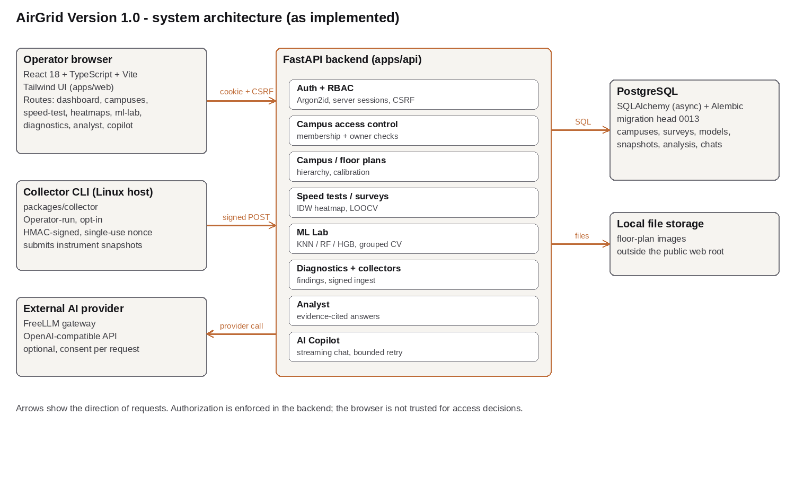

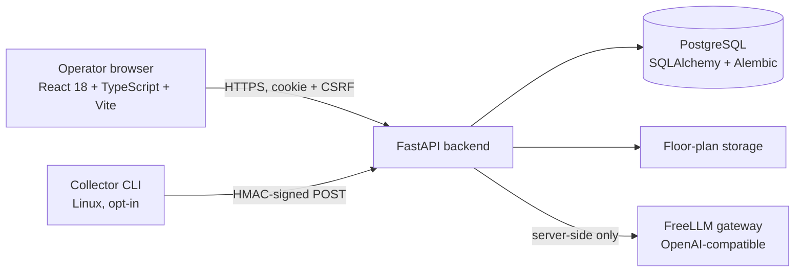

The backend is a modular monolith. Authorization is enforced in the services and endpoints, never trusted to the browser. How evidence flows from a measurement to an AI answer is shown below.

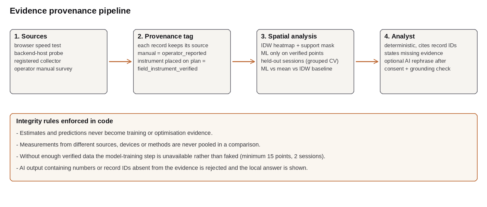

## Technology stack

| Layer | Technology |
|---|---|
| Frontend | React 18, TypeScript, Vite, Tailwind CSS |
| Backend | Python 3.12+, FastAPI, Pydantic v2, SQLAlchemy 2 (async), Alembic |
| Database | PostgreSQL 16 (migration head `0013_ai_copilot_conversations`) |
| Machine learning | scikit-learn: k-nearest neighbours, random forest, histogram gradient boosting; inverse-distance-weighting baseline |
| Security | Argon2id, server-side sessions, CSRF double-submit token, HMAC-SHA256 collector signing |
| AI | OpenAI-compatible gateway (FreeLLM router); provider and key are server-side configuration |
| Testing | pytest + pytest-asyncio + httpx (backend), Playwright (browser verification) |

## Screenshots

Screenshots in the first table come from the **real backend and database** (development data). Those in the second table are rendered by the **real frontend against labelled synthetic API fixtures** (`docs/verification/verify_phase_06.cjs`, which blocks every external request), so they show the actual interface but not live measurements. Fixture images were regenerated from this release's code.

| Real backend | |
|---|---|
| 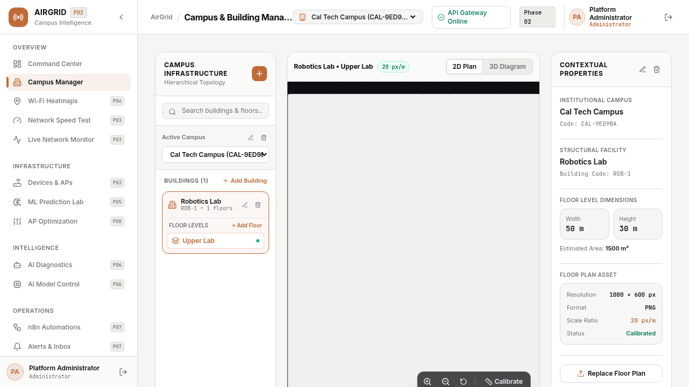 | 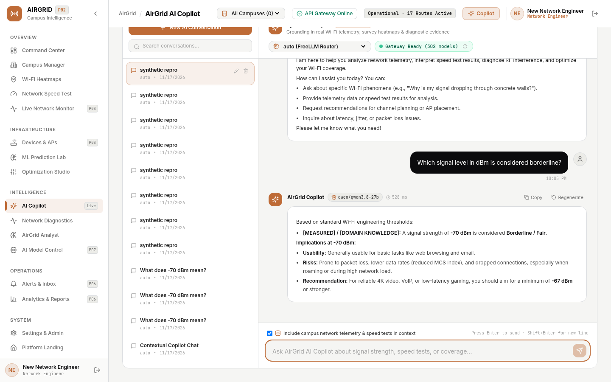 |
| Campus manager: hierarchy and calibrated floor plan | AI Copilot streaming a reply through the live gateway |

| Fixture-backed renders of the real UI | |
|---|---|
| 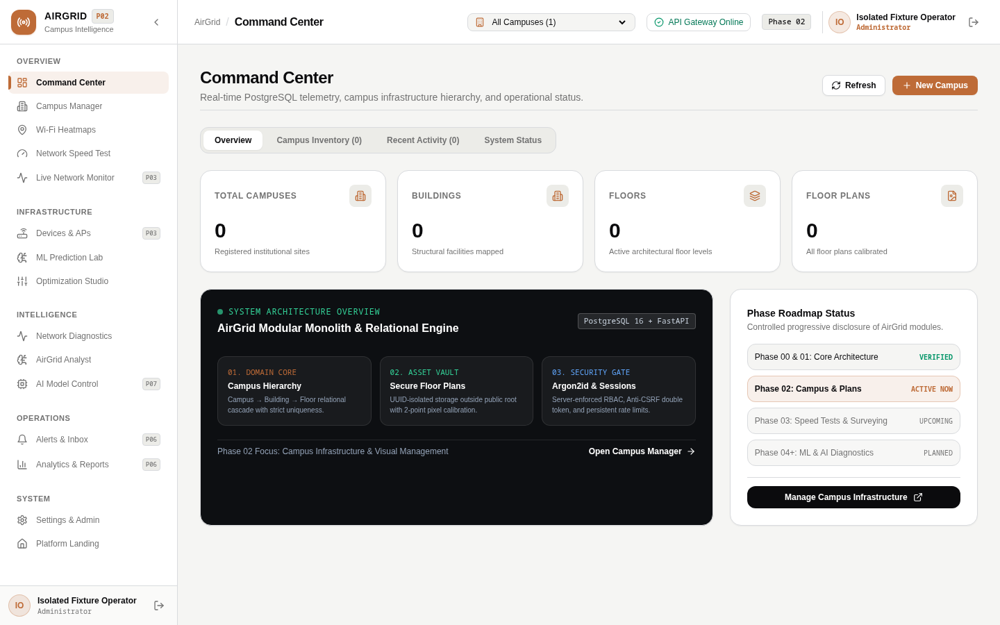 | 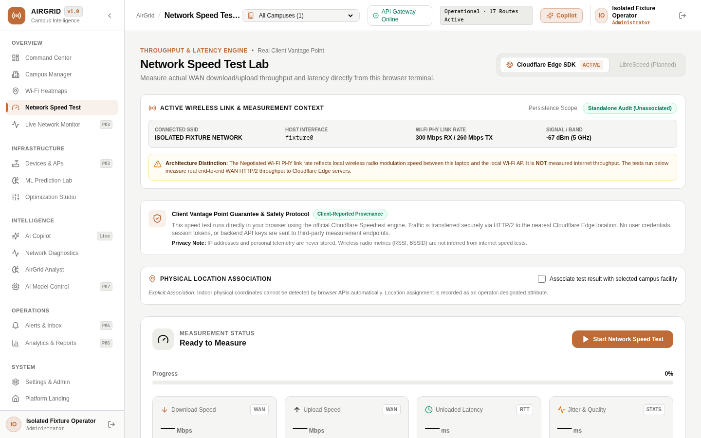 |
| Command Center with verification-state card | Internet speed test |
| 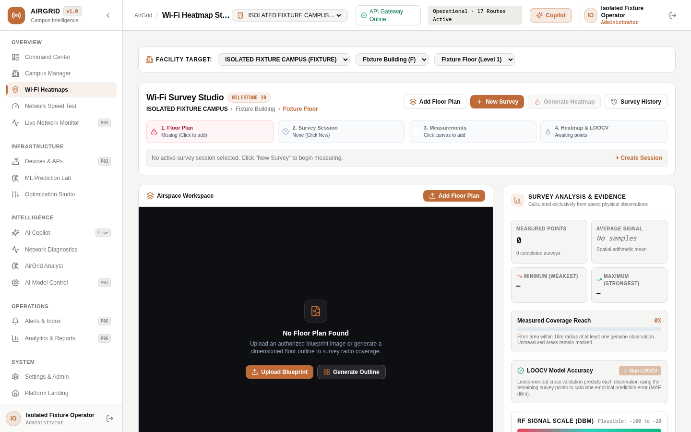 | 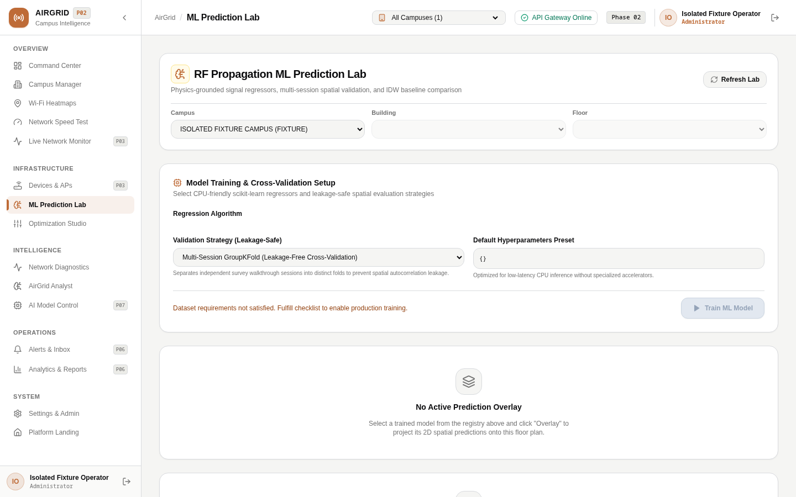 |
| Wi-Fi heatmap studio | ML Lab |
| 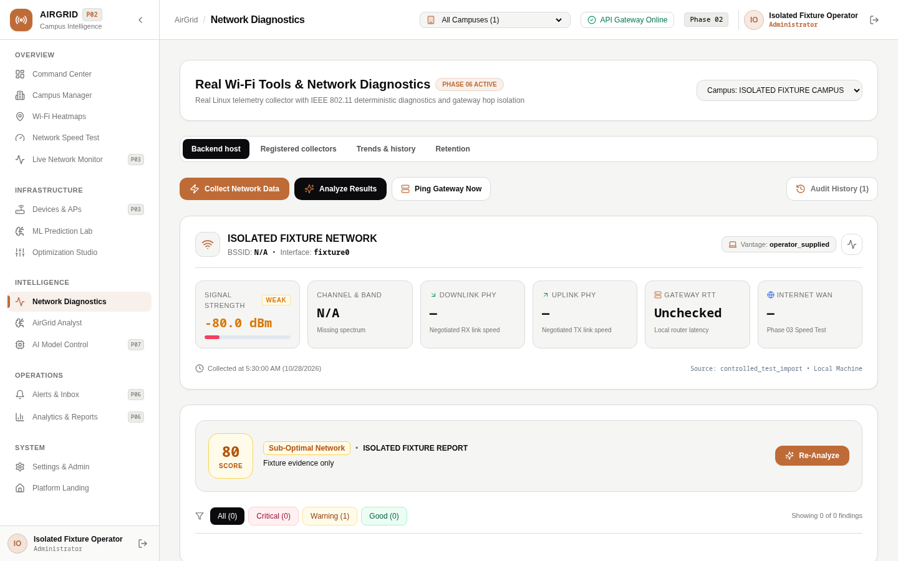 | 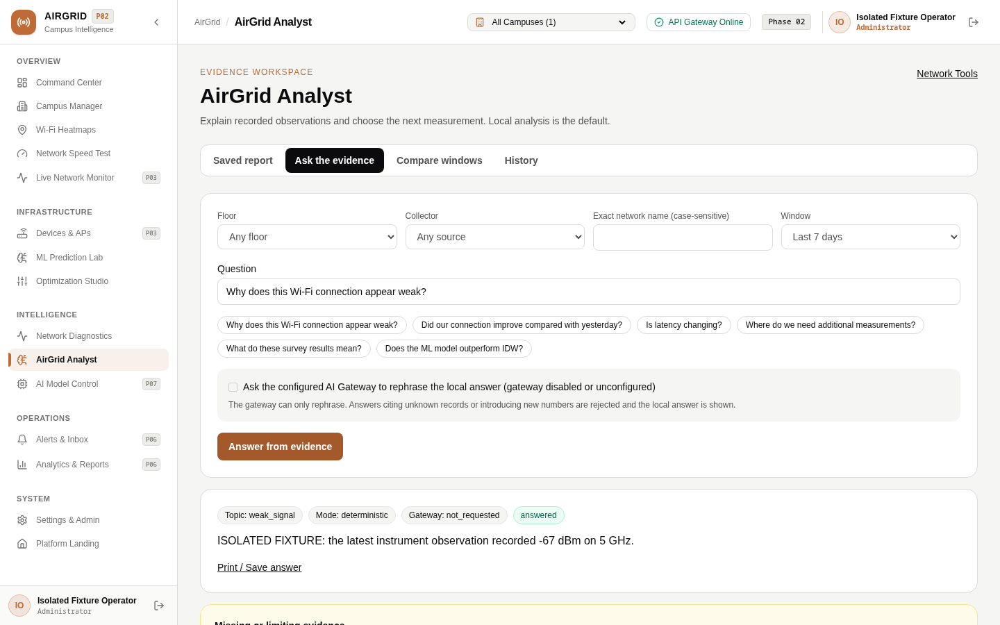 |
| Network diagnostics | Analyst: evidence-cited answer |

Mobile layouts (390 px) are in [`docs/verification/screenshots/`](docs/verification/screenshots/).

## Installation and execution

Requirements: Python 3.12+, [uv](https://docs.astral.sh/uv/), a current Node.js LTS, PostgreSQL 16 (Docker Compose is provided).

```bash
git clone https://github.com/tej-1916/airgrid.git && cd airgrid
cp .env.example .env              # then set a unique AIRGRID_SECRET_KEY (>= 32 chars); never commit .env
docker compose up -d postgres     # or point DATABASE_URL at your own PostgreSQL

# Backend
cd apps/api
uv sync --extra dev
uv run alembic upgrade head       # inspect `alembic current` first if the database already holds data
AIRGRID_BOOTSTRAP_PASSWORD='<choose a strong password>' \
  uv run python -m airgrid.cli bootstrap-admin --email you@example.com   # or omit the variable to be prompted
uv run uvicorn airgrid.main:app --host 127.0.0.1 --port 8000

# Frontend (second terminal)
cd apps/web && npm ci && npm run dev    # http://127.0.0.1:5173
```

Liveness: `/healthz`. Detailed health: `/api/v1/health`. The AI features need an OpenAI-compatible endpoint and key in `.env` (see [AI Gateway configuration](#ai-gateway-configuration)); everything else works without one.

## Tested AI Copilot functionality

The Copilot is the AI chat workspace at `/ai-copilot`. Verified behavior:

- **Streaming through a real provider.** With the FreeLLM gateway configured, a question ("Which signal level in dBm is considered borderline?") streamed a reply from the provider-reported model, shown in the interface with its latency (screenshot above). The model name displayed is the one the provider reports, not the `auto` alias.
- **Timeout and failure handling.** A provider-timeout bug was diagnosed and fixed. The stream now makes at most one bounded retry (transient errors only, and only before any output), returns a structured recoverable error, stores it as an error message that is excluded from later model context, and offers **Retry** without saving the user message twice (`test_copilot_provider_resilience.py`, plus before/after screenshots `copilot_fix_error_retry_desktop.png` and `copilot_fix_retry_success_desktop.png`).
- **Isolation.** Conversations are owner-scoped; one user cannot list, read or write another user's conversation (`test_copilot_tenant_isolation.py`).
- **Context.** Optional inclusion of the caller's own campus telemetry and speed tests as grounding context.
- **Not claimed:** model identity is provider-reported and not independently verified; free-tier provider availability and latency vary; one test that calls the live provider (`test_freellmapi_integration.py`) is skipped when no `.env` is present.

## Testing and verification evidence

Run on the release commit (see [`SUBMISSION_EVIDENCE.md`](docs/submission/SUBMISSION_EVIDENCE.md) for the exact commit and output):

| Check | Result |
|---|---|
| Backend tests (`pytest`, isolated `airgrid_test_db`) | **242 passed, 1 skipped, 0 failed** (the skip is the live-provider test, which needs a `.env`) |
| Authorization regression tests (`tests/test_authz_remediation.py`, synthetic data) | 8 tests; each failed on the unfixed code and passes now |
| Frontend production build (`npm run build`) | succeeds (Vite warns about a large JS chunk; not an error) |
| Browser verification (`verify_phase_06.cjs`) | passed: 10 routes, 2 viewport widths, 0 page errors, 15 external requests blocked, 0 live probes |

```bash
apps/api/.venv/bin/python -m pytest            # from apps/api; forces airgrid_test_db
npm --prefix apps/web run build
AIRGRID_PLAYWRIGHT_MODULE=/path/to/playwright node docs/verification/verify_phase_06.cjs   # needs dev server on :5187
```

### Security review outcome

An automated review of an earlier push reported authorization problems. Each was reproduced by a failing test before being fixed: campus-less diagnostics reports and snapshots, survey comparison, ML prediction maps / promotion / deletion / listing, analyst history and evidence scoping, collector observations, speed-test history, and (found during the final audit) the dashboard inventory, summary and activity feed. The review said "8 issues" but only itemized some of them; the rest were covered by sweeping for the same fail-open pattern, so a finding that does not match the list above should be re-submitted. This is **not** a penetration test or a security certification.

## Project demonstration

1. Sign in at `/auth/login` with the administrator you bootstrapped.
2. **Campus manager**: create a campus, building and floor; upload a floor plan and calibrate its scale.
3. **Speed test**: tick the consent box, start a test, and see it appear in the persisted history.
4. **Heatmaps**: start a survey session, click the plan to record manual points, generate the heatmap and run validation; observe the support mask and the "operator reported" labels.
5. **Diagnostics**: with `AIRGRID_COLLECTOR_ENABLED=true` on a Linux host, collect a snapshot, analyze it, and read the deterministic findings.
6. **AI Analyst / Copilot** (needs an AI key): ask a question and open the cited records; try the Copilot and use **Retry** after stopping the provider.
7. Sign in as a second, unassigned user to see that other campuses' data, history and activity are not visible.

## Post-submission additions (development branch, not part of the `v1.0-submission` checkpoint)

The `v1.0-submission` tag (17 November 2026) is unchanged. Later work on branch `feat/campus-3d-wifi-copilot`:

| Addition | Status |
|---|---|
| **3D Campus page** (`/campus-3d`): three.js viewer for the Blender Mega Campus GLB, orbit/zoom/pan, reset camera, whole building or single floor, floor show/hide, room picking, room panel, 2D plan switch | Implemented; browser-verified (16/16 checks) |
| **Room coverage**: per-room estimate from the existing IDW heatmap engine, coloured good / fair / weak / unknown. Not a radio-propagation simulation | Implemented; unit and API tests |
| **Blender to plan mapping**: `px = W/2 + x*ppm`, `py = H/2 - y*ppm`; glTF `(x, y, z) = (bx, bz, -by)` | Tested with known coordinates |
| **Floor-grounded Copilot**: choose a floor in 3D, ask a question; answers cite room records and state when data is synthetic. Floor authorization runs before the question is stored and before any provider call, on regular and streaming endpoints | Implemented; tests + browser check (provider needed 2 retries) |
| **Data-sharing policy**: private records go only to a loopback gateway unless `AIRGRID_AI_EXTERNAL_CONTEXT_APPROVED=true`; assistant history is withheld otherwise | Implemented; tested |
| **Synthetic demo seed**: `python -m airgrid.demo_seed [--plans-dir DIR]` creates a labelled demo campus (`data_provenance=controlled_test_import`, note "SYNTHETIC DEMO") | Implemented; tested |

**The Blender files are not in this repository.** Set `AIRGRID_CAMPUS_MODEL_DIR` to a folder containing `airgrid_mega_campus.glb` and `campus_geometry.json`; without them the page reports "3D model unavailable".

Demo workflow: run migrations, create an admin (`airgrid-admin bootstrap-admin`), run the seed, start the API and web app, open **3D Campus**, select a floor, click a room, then **Ask the Copilot**. Browser checks: `docs/verification/verify_v1x_campus3d.cjs`, `verify_v1x_copilot.cjs`, `verify_v1x_sweep.cjs` (48 route/width combinations passed with no API or page errors).

Limits: all coverage shown comes from synthetic demo points, so no field accuracy is claimed; the free AI provider is intermittently slow or unavailable; wall attenuation in the 3D model is not used for prediction; no public deployment exists.

**Can the public repository reproduce the 3D demo? No.** The repository contains the viewer, the API, the tests and the seed, but not the model. To run the 3D demo you need your own copy of two files, `airgrid_mega_campus.glb` (glTF 2.0, exported from Blender, node `extras.airgrid_floor` = ground / first / second / roof / site / atrium) and `campus_geometry.json` (floor calibration and room polygons), in one folder:

```bash
export AIRGRID_CAMPUS_MODEL_DIR=/path/to/that/folder      # backend environment
python -m airgrid.demo_seed --plans-dir /path/to/renders   # optional plan images; creates the labelled synthetic demo
```

The seed registers building code `MEGA-MAIN`; the 3D page looks for that code. Without the files the page shows "3D model unavailable" and explains why. Screenshots of the 3D view are not published for the same reason.

**Later-version verification (18 November 2026):** backend 253 passed / 1 skipped; frontend `npm test` 13 passed; `npm run build` succeeds; browser scripts in `docs/verification/` (3D 16/16, Copilot 9/9 after two provider retries, route sweep 48/48). Screenshots: `docs/verification/screenshots/v1x_*.png`. Final report: `docs/submission/AirGrid_Final_Project_Report.pdf` and `.docx` (the checkpoint report `PROJECT_REPORT.*` is kept unchanged). The report still has placeholders for student name, roll number and department.


## Known limitations

- Items listed under *Implemented, with known limitations* above apply.
- **Dependencies.** At the time of release GitHub Dependabot listed open advisories, mainly in development tooling (Vite, esbuild) and a React Router server-rendering path that this client-side application does not use. Python packages with known advisories (Pillow, certifi, dnspython, opentelemetry-api) were upgraded in this release; remaining items are tracked in [`SUBMISSION_EVIDENCE.md`](docs/submission/SUBMISSION_EVIDENCE.md).
- **Privacy of earlier documentation.** Some early screenshots and acceptance notes in `docs/` were captured on the developer's own machine and may show a local hostname, device address or Wi-Fi name. They remain in Git history, which was deliberately not rewritten.
- No production deployment exists; the project has only been run in local development.
- UI placeholder pages (*Devices*, *Monitor*, *Alerts*, *Reports*) do not use backend data and must not be read as implemented features.

## Future work

Continuous monitoring and alerting; physical field acceptance survey and published accuracy of the spatial models; API-backed device, alert and report pages; shared rate-limit store and multi-worker deployment; CI with dependency and security scanning; optional 3D campus visualization; broader provider support for the AI gateway.

## Reference: measurement integrity and limitations

- Manual observations remain `operator_reported`. Controlled imports, estimates and predictions never become training or optimization evidence. `field_instrument_verified` survey points are created **only** by placing a fresh (≤ 15 min), complete, server-owned instrument snapshot at an operator-chosen position on a calibrated plan. Position is never inferred from signal strength or browser APIs.
- The application database currently has **zero instrument-verified survey observations** and no registered collectors. Operational ML training is therefore correctly unavailable; test models use isolated fixtures.
- ML evaluation holds out sessions or spatial blocks; ML, mean and IDW are compared on the same supported held-out points. Models record a floor-plan signature (floor, building, plan file, size, scale, calibration). Any change returns 409 and requires retraining; legacy models without a signature must be retrained.
- Backend-host measurements describe the **backend server**; registered-collector measurements describe the **collector host**; browser speed tests describe the **browser device**. Comparisons never pool sources, devices or methods.
- Browser-supplied telemetry is still accepted but always downgraded to `operator_reported`. The UI now analyzes server-owned snapshots by ID, so its reports keep instrument provenance.
- Diagnostics use documented heuristic thresholds and do not establish congestion, AP faults, WAN bottlenecks or causes from a single sample. The Analyst states missing evidence instead of guessing.
- Candidate AP markers are speculative annotations stored with versions and authors. No wall attenuation, transmit power, physical accessibility or numerical gain is inferred; registered APs are entered manually and unknown transmit power stays unknown.
- Retention never runs automatically. Administrators set a policy, preview the count and apply it with that count; snapshots linked to saved reports or survey points are protected.
- Access is campus-scoped: non-administrators see only campuses they are members of; campus-less records (reports, snapshots, speed tests, analysis history) are visible only to their owner; administrators see everything. Mutations are role-restricted and CSRF-protected. Enforced in the backend (migration `0012_campus_access_control`).
- Rate limits (login, AI gateway, iperf, collector ingest) are per process. A shared store is needed before running multiple API workers.
- Dedicated automation product routes/navigation are removed. Internal webhook signing remains for application infrastructure; no scheduled network actions are enabled.

## Collector configuration

Two collection paths exist; both are disabled until an operator acts.

**Backend host (existing).** `AIRGRID_COLLECTOR_ENABLED=false` is the default. An operator must enable it on the authorized Linux host and explicitly initiate each collection in `/diagnostics`; consent and gateway probing start unchecked. Collection reads connected-interface status; `nmcli --rescan no` avoids surrounding-network scans. No root escalation or passwords are requested. Each collection is stored as a server-owned snapshot and analyzed by ID.

**Registered collectors (new).** An administrator registers a collector in `/diagnostics → Registered collectors`, optionally attributed to the selected floor, and receives a secret **once**. The secret is `HMAC(AIRGRID_SECRET_KEY, id:salt)` and is never stored, so a database dump does not reveal it. Each submission is signed over collector ID, Unix timestamp (±5 min), a single-use nonce and the SHA-256 of the exact body. Bodies are capped at 16 KiB and validated strictly (unknown fields rejected), replays are rejected with 409, and rate limits apply. Remote collectors must reach the API over HTTPS. Rotation and revocation are audited. A browser session cannot submit collector evidence.

```bash
# On the collector host, once per explicit collection (no background loop):
install -m 600 /dev/null ~/.config/airgrid-collector.json   # paste {"collector_id": "...", "secret": "..."}
AIRGRID_COLLECTOR_ENABLED=true apps/api/.venv/bin/python packages/collector/airgrid_collector.py \
  --collect --submit --credentials ~/.config/airgrid-collector.json --api-url http://127.0.0.1:8000
# --ping additionally authorizes up to 3 ICMP probes to the default gateway. Without --submit the reading is printed only.
```

Gateway probing accepts only the discovered default gateway, with at most five probes. iperf supports bounded TCP tests only to literal IPs explicitly listed in `AIRGRID_AUTHORIZED_IPERF_TARGETS` (empty by default). Tests are not scheduled or automatically repeated. Missing tools/permission errors do not become fabricated packet loss.

To turn a fresh observation into survey evidence, click its position in `/heatmaps` within 15 minutes and choose **Place instrument observation**.

## AI Gateway configuration

The default is disabled with no endpoint, approved model or key. Configure `AIRGRID_AI_ENABLED`, `AIRGRID_AI_API_BASE_URL`, `AIRGRID_AI_DEFAULT_MODEL` and, when required, `AIRGRID_AI_API_KEY` server-side. HTTPS endpoints and credential-free loopback local providers are supported. No paid model is required.

Every generation requires explicit per-request approval. Report prioritization sends only minimized metric values, severities and source IDs; provider output may only select existing finding IDs. For questions, `POST /api/v1/analyst/ask/preview` shows the exact outbound text (question, local answer, cited metric values/IDs/times; never network names, addresses, device names, plans or notes) and sends nothing. The provider may only rephrase. Answers citing unknown records, or stating any number absent from the evidence, local answer or question, are rejected and the local answer is shown. Model identity is provider-reported, not independently verified, and is stored in analysis history. Requests have a timeout, zero retries, a 1024-token completion cap and ten generations per minute per process.

The AI Copilot chat stream is separate from analyst generations: it makes at most `AIRGRID_AI_MAX_RETRIES` (default 1) retry for transient failures (timeout, connection error, HTTP 408/429/5xx) and only before any output was produced, optionally on a gateway-listed `AIRGRID_AI_FALLBACK_MODEL`. Failures are returned as recoverable errors with a code, stored as error messages (excluded from later model context), and `retry: true` re-runs the last user message without saving it twice. The displayed model is the provider-reported executing model, not the `auto` alias.

## AI Development Credits

AirGrid is owned, directed and maintained by its repository owner (**tej-1916**), who sets the requirements, reviews the work and decides what ships. All commits remain authored under the owner's account.

[Claude Code](https://claude.com/claude-code) (Anthropic's AI coding agent) assisted development under that direction. Its contributions include:

- Registered collectors, signed ingestion, trends and retention (`42f824b`), and collector fail-closed signing-key handling (`bf05dcf`).
- Instrument observations placed on calibrated survey points and ML model binding (`a5fe4d9`).
- Grounded analyst questions, cross-session comparison and analysis history (`36603ed`).
- Persisted optimization plans with measured before/after comparison (`bd3f537`).
- ORM/migration index reconciliation (`bc7e7e8`), browser fixture verification (`445a922`) and completion documentation (`946f5bf`).
- The AI Copilot provider-failure fix: bounded retry, structured recoverable errors, duplicate-free retry, real stream cancellation, and the accompanying resilience tests.

Commits with material Claude Code contribution carry a standard `Co-Authored-By: Claude … <noreply@anthropic.com>` trailer (`git log --grep="Co-Authored-By: Claude"`). AI-assisted code is held to the same verification standard as any other change: see the limits and results in the documents above, which do not treat AI-written claims as evidence.

**Version 1.0 submission work (November 2026).** Claude Code also performed the authorization remediation (regression tests first, then fixes), the dashboard scoping fix found during the final audit, the Python dependency upgrades, regenerated verification screenshots, the architecture figures, this README and the project report under `docs/submission/`. The repository owner reviews and decides what is published; AI-written statements in these documents were checked against code, tests and recorded output before inclusion.
