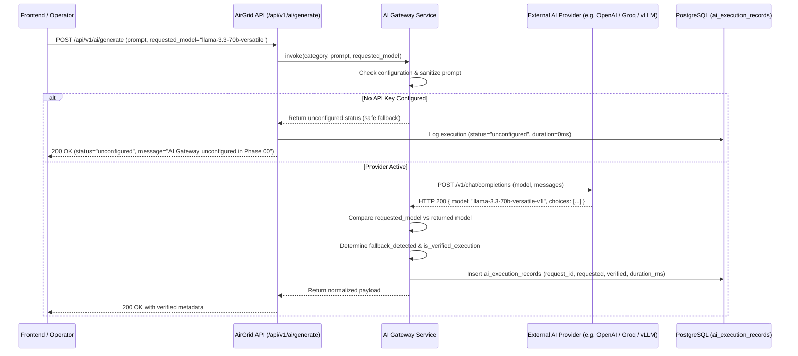

# AIRGRID | AI Gateway Architecture & Model Verification

## 1. Architectural Mission

The AirGrid AI Gateway is a provider-agnostic inference orchestration layer designed to empower network engineers with automated diagnostics, anomaly explanations, and AP placement rationale.

To ensure enterprise compliance and scientific rigor, the Gateway strictly enforces:
- **Zero API Key Leakage:** Keys are kept exclusively in server-side configuration.
- **Provider Independence:** Pluggable adapter architecture supports OpenAI-compatible APIs (Ollama, vLLM, Groq, Together, DeepSeek) as well as direct commercial APIs.
- **Model Truthfulness & Provenance Tracking:** Audits what model was requested versus what model actually executed.



---

## 2. Configuration Parameters

Environment configuration variables:

```bash
# Server-side environment configuration only
AIRGRID_AI_ENABLED=true
AIRGRID_AI_PROVIDER=openai_compatible
AIRGRID_AI_API_BASE_URL=https://api.groq.com/openai/v1
AIRGRID_AI_API_KEY="" # Empty by default in dev/Phase 00
AIRGRID_AI_DEFAULT_MODEL=llama-3.3-70b-versatile
AIRGRID_AI_TIMEOUT_SECONDS=30
AIRGRID_AI_TEMPERATURE=0.2
```

---

## 3. Requested vs. Verified Model Tracking

A critical flaw in naive AI integrations is assuming that the model responding is identical to the model requested. Commercial gateways and proxy routers frequently apply stealth fallbacks or downgrade model variants under load.

### Verification State Machine:
1. **`requested_model`:** The exact string requested by the caller (e.g. `"llama-3.3-70b-versatile"`).
2. **`verified_model`:** The `model` field extracted from the provider's HTTP JSON response payload.
3. **`is_verified_execution`:**
   - Evaluates to `True` IF and ONLY IF the provider returns a non-empty `model` field.
   - Evaluates to `False` if the provider omits the field or the adapter cannot reliably confirm the executing identity.
4. **`fallback_detected`:**
   - Evaluates to `True` if `is_verified_execution` is `True` BUT `verified_model.lower()` does not match `requested_model.lower()`.
5. **No Metadata Fabrication:** If an execution fails, times out, or runs against an offline mock, `verified_model` is explicitly set to `None` and `is_verified_execution` to `False`. Under no circumstances will the gateway fabricate a model execution signature.

---

## 4. Gateway Execution Record Schema

Every request records an immutable row in PostgreSQL:

| Field | Type | Description |
|---|---|---|
| `request_id` | `VARCHAR(100)` | Unique tracking ID (e.g. `req_ai_9a8b7c`) |
| `prompt_category` | `VARCHAR(50)` | `diagnostic`, `optimization_summary`, `anomaly_analysis` |
| `requested_model` | `VARCHAR(100)` | Model explicitly requested |
| `verified_model` | `VARCHAR(100)` | Model returned by provider headers/payload |
| `is_verified_execution` | `BOOLEAN` | Whether identity was verified by provider response |
| `fallback_detected` | `BOOLEAN` | Whether provider switched models behind the scenes |
| `duration_ms` | `INTEGER` | Wall-clock execution time in milliseconds |
| `tokens_prompt` | `INTEGER` | Input tokens consumed |
| `tokens_completion` | `INTEGER` | Output tokens generated |
| `status` | `VARCHAR(50)` | `success`, `failed`, `timeout`, `unconfigured` |

---

## 5. UI Exposure & Privacy Boundaries

1. **Clean Generic Model Names in UI:** The frontend presents standardized model capability tiers (e.g. "Network Diagnostic Engine (Llama 3.3 70B)") without exposing internal adapter class names or internal proxy endpoints.
2. **Provenance Badging:** When viewing diagnostic reports, the UI presents an inspection badge indicating:
   - Verified Model: Green checkmark with exact model tag.
   - Unverified / Fallback: Amber badge alerting the operator to model substitution.
