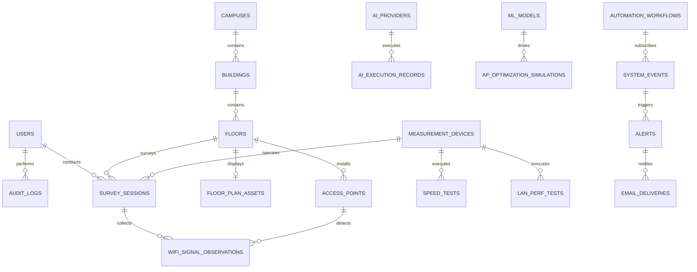

# AIRGRID | Database Architecture & Schema Design

## 1. Overview & Principles

The AirGrid persistence layer is built on PostgreSQL 16+. The design adheres to:
- **Strict Foreign Key Constraints:** Guarantees referential integrity across hierarchical campus physical layouts (Campus -> Building -> Floor -> FloorPlan).
- **Time-Series Telemetry Optimization:** High-frequency observation tables are structured with compound indexes on `(floor_id, observed_at)` and `(device_id, observed_at)` to support rapid heatmap generation and spatial queries.
- **Auditability & Provenance:** Every critical administrative action, AI invocation, and optimization run records timestamps, actor IDs, and immutable metadata.
- **Data Lifecycle & Retention:** High-volume raw observations transition through partitioning or scheduled roll-up jobs into hourly/daily summary tables.

---

## 2. Entity-Relationship Overview

---

## 3. Detailed Entity Definitions

### 3.1 Authentication & Security Entities

#### `users`
Represents platform operators, network engineers, and field technicians.
- `id`: UUID (Primary Key, default `gen_random_uuid()`)
- `email`: VARCHAR(255) (Unique, Not Null, Indexed)
- `hashed_password`: VARCHAR(255) (Not Null)
- `full_name`: VARCHAR(255) (Not Null)
- `role`: VARCHAR(50) (Enum: `super_admin`, `network_admin`, `field_tech`, `observer`, default `'observer'`)
- `is_active`: BOOLEAN (Default TRUE, Not Null)
- `created_at`: TIMESTAMPTZ (Default `now()`, Not Null)
- `updated_at`: TIMESTAMPTZ (Default `now()`, Not Null)

#### `audit_logs`
Immutable record of security-sensitive operations.
- `id`: UUID (Primary Key)
- `actor_id`: UUID (Foreign Key `users.id`, Nullable for system actions)
- `action`: VARCHAR(100) (Not Null)
- `resource_type`: VARCHAR(100) (Not Null)
- `resource_id`: VARCHAR(100) (Nullable)
- `payload`: JSONB (Default `{}`)
- `ip_address`: VARCHAR(45) (Nullable)
- `created_at`: TIMESTAMPTZ (Default `now()`, Not Null, Indexed)

---

### 3.2 Physical Campus Topology Entities

#### `campuses`
Top-level institution or regional facility.
- `id`: UUID (Primary Key)
- `name`: VARCHAR(255) (Not Null)
- `code`: VARCHAR(50) (Unique, Not Null)
- `latitude`: DOUBLE PRECISION (Nullable)
- `longitude`: DOUBLE PRECISION (Nullable)
- `address`: TEXT (Nullable)
- `created_at`: TIMESTAMPTZ (Default `now()`, Not Null)
- `updated_at`: TIMESTAMPTZ (Default `now()`, Not Null)

#### `buildings`
Individual structure inside a campus.
- `id`: UUID (Primary Key)
- `campus_id`: UUID (Foreign Key `campuses.id` ON DELETE CASCADE, Not Null, Indexed)
- `name`: VARCHAR(255) (Not Null)
- `building_code`: VARCHAR(50) (Not Null)
- `floors_count`: INTEGER (Default 1, Not Null)
- `created_at`: TIMESTAMPTZ (Default `now()`, Not Null)

#### `floors`
Specific vertical level of a building.
- `id`: UUID (Primary Key)
- `building_id`: UUID (Foreign Key `buildings.id` ON DELETE CASCADE, Not Null, Indexed)
- `floor_number`: INTEGER (Not Null)
- `name`: VARCHAR(100) (Not Null)
- `dimensions_width_m`: DOUBLE PRECISION (Default 50.0, Not Null)
- `dimensions_height_m`: DOUBLE PRECISION (Default 30.0, Not Null)
- `created_at`: TIMESTAMPTZ (Default `now()`, Not Null)

#### `floor_plan_assets`
Raster or vector architectural layout asset for a floor.
- `id`: UUID (Primary Key)
- `floor_id`: UUID (Foreign Key `floors.id` ON DELETE CASCADE, Unique, Not Null)
- `file_path`: VARCHAR(512) (Not Null)
- `file_format`: VARCHAR(20) (Enum: `png`, `svg`, `webp`, Not Null)
- `pixel_width`: INTEGER (Not Null)
- `pixel_height`: INTEGER (Not Null)
- `scale_pixels_per_meter`: DOUBLE PRECISION (Not Null, Default 20.0)
- `created_at`: TIMESTAMPTZ (Default `now()`, Not Null)

---

### 3.3 Network Hardware & Surveying Entities

#### `access_points`
Physical wireless access points deployed or planned.
- `id`: UUID (Primary Key)
- `floor_id`: UUID (Foreign Key `floors.id` ON DELETE SET NULL, Nullable, Indexed)
- `name`: VARCHAR(255) (Not Null)
- `mac_address`: VARCHAR(17) (Unique, Not Null, Indexed)
- `model`: VARCHAR(100) (Nullable)
- `vendor`: VARCHAR(100) (Nullable)
- `x_coord`: DOUBLE PRECISION (Nullable)
- `y_coord`: DOUBLE PRECISION (Nullable)
- `channel_24ghz`: INTEGER (Nullable)
- `channel_5ghz`: INTEGER (Nullable)
- `tx_power_dbm`: DOUBLE PRECISION (Default 20.0, Not Null)
- `status`: VARCHAR(50) (Enum: `active`, `degraded`, `offline`, `planned`, Default `'active'`)
- `created_at`: TIMESTAMPTZ (Default `now()`, Not Null)

#### `measurement_devices`
Laptops, smartphones, or fixed probes logging network data.
- `id`: UUID (Primary Key)
- `device_fingerprint`: VARCHAR(64) (Unique, Not Null, Indexed)
- `device_name`: VARCHAR(255) (Not Null)
- `device_type`: VARCHAR(50) (Enum: `field_laptop`, `mobile_survey`, `fixed_probe`, `browser_client`)
- `os_info`: VARCHAR(255) (Nullable)
- `is_authorized`: BOOLEAN (Default FALSE, Not Null)
- `last_seen_at`: TIMESTAMPTZ (Nullable)
- `created_at`: TIMESTAMPTZ (Default `now()`, Not Null)

#### `survey_sessions`
Discrete walk-through or stationary survey conducted by a technician.
- `id`: UUID (Primary Key)
- `floor_id`: UUID (Foreign Key `floors.id` ON DELETE CASCADE, Not Null, Indexed)
- `technician_id`: UUID (Foreign Key `users.id` ON DELETE SET NULL, Nullable)
- `device_id`: UUID (Foreign Key `measurement_devices.id` ON DELETE SET NULL, Nullable)
- `session_name`: VARCHAR(255) (Not Null)
- `started_at`: TIMESTAMPTZ (Default `now()`, Not Null)
- `completed_at`: TIMESTAMPTZ (Nullable)
- `status`: VARCHAR(50) (Enum: `in_progress`, `completed`, `aborted`, Default `'in_progress'`)
- `created_at`: TIMESTAMPTZ (Default `now()`, Not Null)

#### `wifi_signal_observations`
Point-in-time RF readings mapped to 2D floor coordinates.
- `id`: UUID (Primary Key)
- `survey_session_id`: UUID (Foreign Key `survey_sessions.id` ON DELETE CASCADE, Not Null, Indexed)
- `floor_id`: UUID (Foreign Key `floors.id` ON DELETE CASCADE, Not Null, Indexed)
- `bssid`: VARCHAR(17) (Not Null, Indexed)
- `ssid`: VARCHAR(64) (Not Null)
- `rssi_dbm`: DOUBLE PRECISION (Not Null) -- e.g. -65 dBm
- `frequency_mhz`: INTEGER (Not Null) -- e.g. 5180 MHz
- `channel`: INTEGER (Not Null)
- `noise_dbm`: DOUBLE PRECISION (Nullable)
- `snr_db`: DOUBLE PRECISION (Nullable)
- `x_coord`: DOUBLE PRECISION (Not Null)
- `y_coord`: DOUBLE PRECISION (Not Null)
- `observed_at`: TIMESTAMPTZ (Default `now()`, Not Null, Indexed)

---

### 3.4 Network Performance & Active Testing Entities

#### `internet_speed_tests`
WAN bandwidth, latency, and jitter measurements.
- `id`: UUID (Primary Key)
- `device_id`: UUID (Foreign Key `measurement_devices.id` ON DELETE SET NULL, Nullable, Indexed)
- `floor_id`: UUID (Foreign Key `floors.id` ON DELETE SET NULL, Nullable, Indexed)
- `vantage_point`: VARCHAR(50) (Enum: `client_browser`, `field_laptop`, `server_backend`, Not Null)
- `provider_engine`: VARCHAR(50) (Enum: `cloudflare_speedtest`, `librespeed`, `iperf3_wan`)
- `download_mbps`: DOUBLE PRECISION (Nullable)
- `upload_mbps`: DOUBLE PRECISION (Nullable)
- `latency_ms`: DOUBLE PRECISION (Nullable)
- `jitter_ms`: DOUBLE PRECISION (Nullable)
- `packet_loss_pct`: DOUBLE PRECISION (Nullable)
- `server_location`: VARCHAR(100) (Nullable)
- `client_ip_hashed`: VARCHAR(64) (Nullable)
- `x_coord`: DOUBLE PRECISION (Nullable)
- `y_coord`: DOUBLE PRECISION (Nullable)
- `executed_at`: TIMESTAMPTZ (Default `now()`, Not Null, Indexed)

#### `lan_performance_tests`
Authorized local campus network iperf3 benchmarks.
- `id`: UUID (Primary Key)
- `device_id`: UUID (Foreign Key `measurement_devices.id` ON DELETE SET NULL, Nullable, Indexed)
- `floor_id`: UUID (Foreign Key `floors.id` ON DELETE SET NULL, Nullable)
- `target_host`: VARCHAR(255) (Not Null)
- `protocol`: VARCHAR(10) (Enum: `TCP`, `UDP`, Default `'TCP'`)
- `throughput_mbps`: DOUBLE PRECISION (Not Null)
- `jitter_ms`: DOUBLE PRECISION (Nullable)
- `retransmits`: INTEGER (Nullable)
- `executed_at`: TIMESTAMPTZ (Default `now()`, Not Null, Indexed)

---

### 3.5 AI & Machine Learning Entities

#### `ai_providers`
Configured LLM backends (OpenAI-compatible, Groq, Ollama, Anthropic).
- `id`: UUID (Primary Key)
- `name`: VARCHAR(100) (Unique, Not Null)
- `base_url`: VARCHAR(512) (Not Null)
- `is_active`: BOOLEAN (Default TRUE, Not Null)
- `created_at`: TIMESTAMPTZ (Default `now()`, Not Null)

#### `ai_execution_records`
Audit trail of every prompt executed against an AI provider.
- `id`: UUID (Primary Key)
- `provider_id`: UUID (Foreign Key `ai_providers.id` ON DELETE SET NULL, Nullable)
- `request_id`: VARCHAR(100) (Unique, Not Null, Indexed)
- `prompt_category`: VARCHAR(50) (Enum: `diagnostic`, `optimization_summary`, `anomaly_analysis`)
- `requested_model`: VARCHAR(100) (Not Null)
- `verified_model`: VARCHAR(100) (Nullable)
- `is_verified_execution`: BOOLEAN (Default FALSE, Not Null)
- `fallback_detected`: BOOLEAN (Default FALSE, Not Null)
- `tokens_prompt`: INTEGER (Nullable)
- `tokens_completion`: INTEGER (Nullable)
- `duration_ms`: INTEGER (Not Null)
- `status`: VARCHAR(50) (Enum: `success`, `failed`, `timeout`, `unconfigured`)
- `error_message`: TEXT (Nullable)
- `executed_at`: TIMESTAMPTZ (Default `now()`, Not Null, Indexed)

#### `ml_models`
Metadata and evaluation tracking for RF signal prediction models.
- `id`: UUID (Primary Key)
- `model_name`: VARCHAR(100) (Not Null)
- `model_version`: VARCHAR(50) (Not Null)
- `algorithm`: VARCHAR(100) (Enum: `random_forest_regressor`, `gradient_boosting`, `knn_spatial`, `itu_indoor_pathloss`)
- `artifact_path`: VARCHAR(512) (Not Null) -- Path to local joblib artifact
- `rmse_db`: DOUBLE PRECISION (Nullable)
- `mae_db`: DOUBLE PRECISION (Nullable)
- `r2_score`: DOUBLE PRECISION (Nullable)
- `is_current_champion`: BOOLEAN (Default FALSE, Not Null)
- `trained_at`: TIMESTAMPTZ (Default `now()`, Not Null)

#### `ap_optimization_simulations`
Results of Monte Carlo or heuristic AP placement/channel simulations.
- `id`: UUID (Primary Key)
- `floor_id`: UUID (Foreign Key `floors.id` ON DELETE CASCADE, Not Null, Indexed)
- `model_id`: UUID (Foreign Key `ml_models.id` ON DELETE SET NULL, Nullable)
- `budget_ap_count`: INTEGER (Not Null)
- `optimized_coverage_pct`: DOUBLE PRECISION (Not Null)
- `weak_zone_reduction_pct`: DOUBLE PRECISION (Not Null)
- `ap_coordinates_json`: JSONB (Not Null)
- `executed_at`: TIMESTAMPTZ (Default `now()`, Not Null)

---

### 3.6 Automation & Observability Entities

#### `automation_workflows`
Registered n8n webhook pipelines.
- `id`: UUID (Primary Key)
- `name`: VARCHAR(100) (Not Null)
- `event_trigger`: VARCHAR(100) (Not Null, Indexed) -- e.g. `network.degradation`, `survey.completed`
- `webhook_url`: VARCHAR(512) (Not Null)
- `is_active`: BOOLEAN (Default TRUE, Not Null)
- `created_at`: TIMESTAMPTZ (Default `now()`, Not Null)

#### `system_events`
Internal event log for all platform occurrences.
- `id`: UUID (Primary Key)
- `event_type`: VARCHAR(100) (Not Null, Indexed)
- `source`: VARCHAR(100) (Not Null)
- `payload`: JSONB (Not Null, Default `{}`)
- `occurred_at`: TIMESTAMPTZ (Default `now()`, Not Null, Indexed)

#### `alerts`
Actionable notifications generated from degradation or dead zones.
- `id`: UUID (Primary Key)
- `event_id`: UUID (Foreign Key `system_events.id` ON DELETE SET NULL, Nullable)
- `severity`: VARCHAR(20) (Enum: `info`, `warning`, `critical`, Not Null, Indexed)
- `title`: VARCHAR(255) (Not Null)
- `description`: TEXT (Not Null)
- `status`: VARCHAR(50) (Enum: `open`, `acknowledged`, `resolved`, Default `'open'`)
- `created_at`: TIMESTAMPTZ (Default `now()`, Not Null, Indexed)
- `resolved_at`: TIMESTAMPTZ (Nullable)

#### `email_deliveries`
Record of outbound emails triggered via n8n or platform notification workers.
- `id`: UUID (Primary Key)
- `alert_id`: UUID (Foreign Key `alerts.id` ON DELETE SET NULL, Nullable)
- `recipient_email`: VARCHAR(255) (Not Null)
- `subject`: VARCHAR(255) (Not Null)
- `delivery_status`: VARCHAR(50) (Enum: `queued`, `sent`, `failed`, `simulated`, Default `'simulated'`)
- `provider_response_id`: VARCHAR(100) (Nullable)
- `attempted_at`: TIMESTAMPTZ (Default `now()`, Not Null)

---

## 4. Retention & Partitioning Strategy

1. **`wifi_signal_observations`:**
   - Anticipated volume: 100,000 to 1,000,000 points per campus per quarter.
   - Recommended strategy: PostgreSQL declarative range partitioning by month on `observed_at`. Retain raw points for 180 days; roll up into 1m x 1m spatial grid averages for long-term historical comparison.
2. **`audit_logs` & `ai_execution_records`:**
   - Retained indefinitely in append-only tables for compliance and model evaluation drift tracking.
3. **`speed_tests`:**
   - Retained for 365 days, then summarized into monthly 95th percentile metrics.

## 4. Current schema additions (migrations 0008–0011, 2026-10-28)

All additive; head `0011_optimization_plans`; `alembic check` clean.

- **0008** — models now name indexes as migrations 0001–0007 created them; adds `ix_ai_execution_records_executed_at`, `ix_internet_speed_tests_floor_id`, `ix_lan_performance_tests_device_id`, `ix_lan_performance_tests_executed_at`, `ix_wifi_signal_observations_survey_session_id`.
- **0009** — `network_collectors` (name, host label, campus/building/floor scope, status, `secret_salt`, creator, revocation, last seen/status, accepted/rejected counts); `network_telemetry_snapshots` gains `collector_id`, `submission_nonce` (unique with collector), `collection_status`, `collection_error`, `connection_state`; `survey_measurements.source_telemetry_snapshot_id` (unique, SET NULL); `data_retention_policies` (dataset PK, retention days, aggregate flag); `telemetry_daily_aggregates` (collector, floor, vantage, provenance, day, sample count, metrics JSON of count/sum/min/max).
- **0010** — `analysis_records` (kind, question, scope, evidence refs, freshness, mode, gateway status, provider-reported model, outcome, error, result, user, created_at).
- **0011** — `optimization_plans` (floor/building/campus, network label, name, notes, status, markers, evidence refs, version, author, updater); `access_points.tx_power_dbm` nullable, plus `notes`, `created_by_id`. AP `x_coord`/`y_coord` are normalized plan coordinates entered manually.

Collector secrets are not stored: they are `HMAC(AIRGRID_SECRET_KEY, "airgrid-collector:{id}:{salt}")`.
