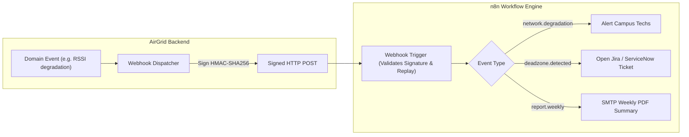

# AIRGRID | n8n Automation & Webhook Integration Design

## 1. Overview & Automation Architecture

AirGrid integrates with **n8n** (an open-source node-based workflow orchestration engine) to handle asynchronous notification dispatch, automated alerting, periodic reporting, and IT service management (ITSM) ticketing integrations.

By decoupling workflow logic into n8n:
- The core AirGrid API remains fast, responsive, and uncluttered by third-party email/SMS/Slack/Jira SDKs.
- Operators can modify escalation trees, alert intervals, and email templates without rebuilding or redeploying backend containers.



---

## 2. Event Types & Triggers

AirGrid defines seven standard system events dispatched to n8n:

| Event Type | Trigger Condition | Target Action in n8n |
|---|---|---|
| `network.degradation` | Access point client RSSI falls below -75 dBm for >5 consecutive minutes | Immediate push notification to on-duty network engineer |
| `deadzone.detected` | Survey session identifies an indoor area >25 m² with < -80 dBm coverage | Open site survey work order in ticketing system |
| `ai.diagnostic_report` | AI Diagnostic engine finishes root-cause analysis on an alert | Attach natural language diagnosis to incident ticket |
| `ml.training_completed` | New RF signal prediction model artifact trained and validated | Notify engineering team of new champion model metrics |
| `report.weekly_summary` | Scheduled cron (e.g. Monday 06:00 UTC) | Generate and distribute executive campus Wi-Fi KPI email |
| `email.delivery_request` | Generic platform email request (e.g. password reset or report link) | Send transactional email via enterprise SMTP/SendGrid |
| `automation.failure` | Webhook delivery failure or n8n workflow execution error | Escalate to system audit log and secondary pager |

---

## 3. Webhook Security Architecture

### 3.1 HMAC-SHA256 Signing
Every outbound HTTP POST to n8n includes a cryptographically secure signature computed using an HMAC secret key shared between AirGrid and n8n (`AIRGRID_WEBHOOK_SECRET`).

**Signature Computation:**
```python
signature = hmac.new(
    key=secret.encode("utf-8"),
    msg=f"{timestamp}.{raw_json_body}".encode("utf-8"),
    digestmod=hashlib.sha256
).hexdigest()
```

### 3.2 Outbound HTTP Headers
- `X-AirGrid-Signature`: `sha256=<computed_hex_digest>`
- `X-AirGrid-Timestamp`: Epoch seconds when request was generated (e.g. `1728894720`)
- `X-AirGrid-Delivery-ID`: UUIDv4 uniquely identifying this dispatch attempt
- `Content-Type`: `application/json`

### 3.3 Replay Prevention
The receiving n8n workflow (via custom Code node) or API gateway enforces:
- `abs(current_timestamp - header_timestamp) <= 300` seconds (5-minute sliding window).
- Replays older than 5 minutes or timestamps in the future are discarded immediately with HTTP 401.

### 3.4 Idempotency & Deduplication
Every payload contains an `event_id` (UUID). The n8n workflow stores processed `event_id` keys in an n8n static cache or Redis store with a 24-hour TTL. Duplicate deliveries are acknowledged with HTTP 200 without re-triggering external alerts.

### 3.5 Bounded Retries & Backoff
In case of network timeout or 5xx responses from n8n:
- **Max Retries:** 3 attempts
- **Backoff Strategy:** Exponential backoff with jitter (1s, 4s, 16s).
- **Dead Letter Logging:** If all retries fail, an entry is written to `system_events` with status `delivery_failed`.

---

## 4. Webhook Payload Schemas

### 4.1 Schema Envelope
```json
{
  "$schema": "https://json-schema.org/draft/2020-12/schema",
  "type": "object",
  "required": ["event_id", "event_type", "severity", "timestamp", "data"],
  "properties": {
    "event_id": { "type": "string", "format": "uuid" },
    "event_type": { "type": "string" },
    "severity": { "type": "string", "enum": ["info", "warning", "critical"] },
    "timestamp": { "type": "string", "format": "date-time" },
    "data": { "type": "object" }
  }
}
```

### 4.2 Example: `network.degradation`
```json
{
  "event_id": "7b0a3c2e-4b71-460d-9538-348e359d9c22",
  "event_type": "network.degradation",
  "severity": "warning",
  "timestamp": "2026-10-14T08:45:00Z",
  "data": {
    "campus_id": "8a3138b5-...",
    "campus_name": "North Campus Engineering",
    "building_code": "NC-ENG",
    "floor_name": "Floor 2",
    "ap_name": "AP-ENG-201",
    "bssid": "aa:bb:cc:dd:ee:01",
    "mean_rssi_dbm": -81.4,
    "drop_delta_dbm": -16.2,
    "affected_client_count": 18,
    "detected_at": "2026-10-14T08:44:30Z"
  }
}
```

---

## 5. Phase 00 Scope Boundary

- In Phase 00, the Webhook Dispatcher service is implemented and tested with mock endpoints and signature verification tests.
- **No real emails or external notifications are dispatched during Phase 00.**
