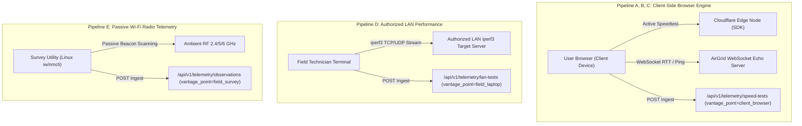

# AIRGRID | Network Testing & Measurement Architecture

## 1. Overview & Safety Mandate

Network measurements in AirGrid are designed around a zero-compromise architectural principle:
> **Measurements must strictly reflect their true vantage point, must never execute without explicit user authorization, and must never disrupt campus production traffic.**

---

## 2. Measurement Pipelines

### Pipeline A: Internet Download & Upload Throughput (WAN)
- **Engine:** Cloudflare Speedtest JS SDK running directly inside the client's browser context.
- **Mechanism:** HTTP/2 chunked transfer over TLS to nearest Cloudflare Edge Point of Presence (PoP).
- **Client Representation:** Captures the true bottleneck between the end-user's wireless NIC, the AP, campus core switch, and the upstream WAN gateway.
- **Safety Bounds:**
  - Default test duration: 10 seconds download, 10 seconds upload.
  - Maximum data cap per test run: 150 MB.
  - Rate limiting: Maximum 1 full speed test every 60 seconds per client IP.

### Pipeline B: Latency and Jitter
- **Mechanism:** High-frequency WebSocket ping/pong frame bursts (64 bytes each, 20 samples at 50ms intervals) targeted at both:
  1. The local AirGrid gateway instance (measures pure LAN/Wi-Fi last-mile latency).
  2. The upstream Cloudflare/LibreSpeed edge (measures end-to-end WAN latency).
- **Metrics Computed:**
  - Min, Median, and 95th percentile RTT (Round Trip Time) in milliseconds.
  - RFC 3550 Jitter: Mean deviation between consecutive RTT samples.

### Pipeline C: Packet Loss
- **Mechanism:**
  - In browser contexts: Sequence-numbered WebSocket message bursts with ACK tracking. Unacknowledged packets within a 500ms sliding window register as dropped frames.
  - In technician LAN contexts (iperf3): Native UDP datagram sequence analysis measuring lost and out-of-order packets.

### Pipeline D: Authorized Local LAN Throughput
- **Engine:** `iperf3` client utility bound to designated campus probe servers.
- **Authorization Guardrails:**
  - Permitted only for users with the `NetworkAdmin` or `FieldTechnician` role.
  - Target server list is strictly allowlisted in server configuration (`AIRGRID_AUTHORIZED_IPERF_TARGETS`).
  - No arbitrary IP or subnet scanning is permitted.
  - Default execution: 5-second single TCP stream, bandwidth target capped at 500 Mbps.

### Pipeline E: Passive Wi-Fi Radio Telemetry
- **Engine:** Linux `iw` / `nmcli` or Web Wi-Fi diagnostic hooks on dedicated survey machines.
- **Metrics Collected:**
  - Current Associated BSSID and SSID
  - Received Signal Strength Indicator (RSSI in dBm)
  - Frequency (2.4 GHz, 5 GHz, 6 GHz band channels)
  - Signal-to-Noise Ratio (SNR in dB)
  - Link speed / PHY rate (e.g. 802.11ax 1201 Mbps)
- **Passive Nature:** No active probing, deauthentication, or frame injection is ever performed.

---

## 3. Vantage Point Integrity Rules

1. **Strict Metadata Tagging:** Every speed test record written to the database contains an immutable `vantage_point` field:
   - `client_browser`: Run from user's browser device.
   - `field_laptop`: Run from technician survey equipment.
   - `server_backend`: Run from AirGrid's containerized host.
2. **Never Fabricate or Conflate:**
   - Server-side throughput to the internet (e.g., 10 Gbps datacenter pipe) must never be displayed in the UI as the client's Wi-Fi throughput.
   - The UI clearly labels the vantage point on every chart, card, and report.

---

## 4. Privacy & Ethical Guardrails

- **BSSID Obfuscation:** In public/observer-facing analytics views, the middle octets of MAC addresses and BSSIDs are masked (`AA:BB:**:**:EE:01`).
- **No Packet Payload Capture:** AirGrid measures link headers, timing, and synthetic test chunks. It never inspects, captures, or logs user traffic packets.
- **Location Consent:** Field survey mapping requires explicit technician confirmation before recording coordinates on a floor plan.
