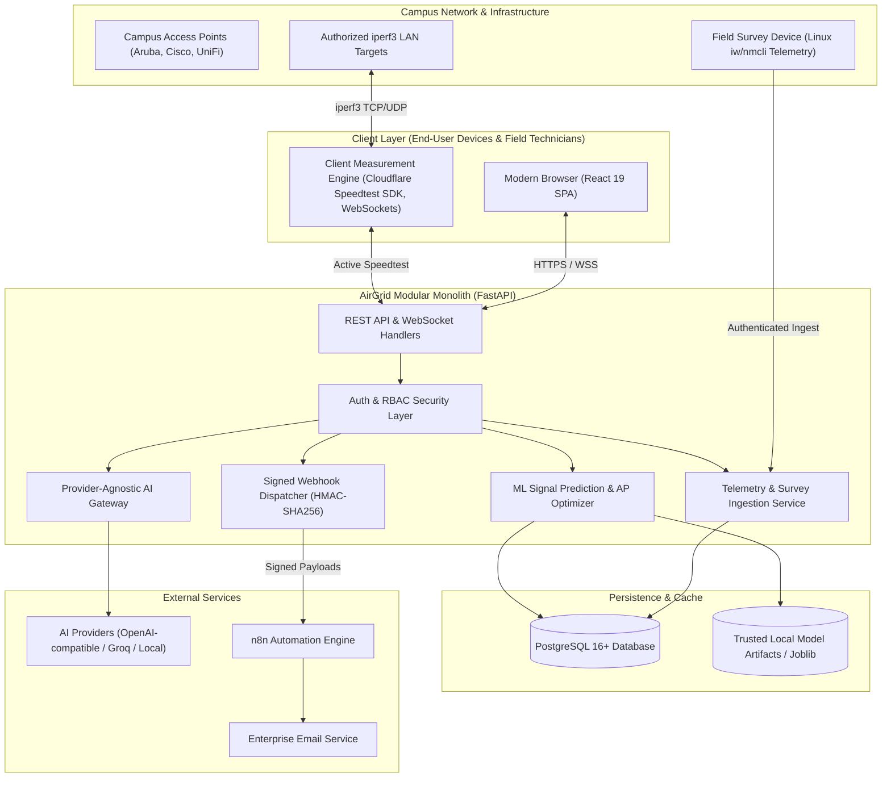

# AIRGRID | System Architecture Specification

## 1. Executive Overview

AirGrid is an enterprise-grade, AI-powered Campus Network Intelligence, Monitoring, and Optimization Platform. Designed specifically for university campuses, research facilities, and multi-facility enterprises, AirGrid bridges the gap between passive Wi-Fi monitoring and active end-user experience intelligence.

The platform continuously assesses Wi-Fi coverage quality, measures actual client and LAN network performance, identifies dead zones, predicts signal propagation via physics-grounded machine learning, simulates and optimizes Access Point (AP) placements, and orchestrates remediation workflows through n8n automation and verified AI diagnostics.



---

## 2. Architectural Paradigm: Modular Monolith

To avoid the operational friction, deployment fragility, and data boundary synchronization overhead of premature microservices, AirGrid is structured as a **Modular Monolith**.

### 2.1 Core Architectural Principles
1. **Single Deployable Unit with Strict Internal Boundaries:** The backend runs as a single FastAPI service while enforcing strict domain separation in code (`core`, `models`, `schemas`, `services`, `api`).
2. **Domain-Isolated Schemas & Services:** Each domain module owns its logic and data access patterns. Cross-domain communication occurs through well-defined service interfaces rather than raw database joins across unrelated entities.
3. **Stateless Backend Instances:** Application state is stored exclusively in PostgreSQL or deterministic file artifacts (e.g. trained ML weights), allowing horizontal scaling behind standard load balancers.
4. **Decoupled Asynchronous Tasks:** Heavy computations (such as path-loss ML model training or complex AP coverage ray-tracing simulations) execute asynchronously to maintain sub-50ms API response times.

---

## 3. High-Level Component Topology

```
airgrid/
├── apps/
│   ├── api/                   # FastAPI Backend (Modular Monolith)
│   │   ├── migrations/        # Alembic database migrations
│   │   ├── src/airgrid/       # Python application source
│   │   │   ├── api/v1/        # Versioned HTTP & WS endpoints
│   │   │   ├── core/          # App config, DB engines, security, logging
│   │   │   ├── models/        # SQLAlchemy 2.0 ORM entities
│   │   │   ├── schemas/       # Pydantic v2 data validation schemas
│   │   │   ├── services/      # Domain business logic (AI Gateway, Webhooks, etc.)
│   │   │   └── main.py        # Application entrypoint & ASGI factory
│   │   └── tests/             # Pytest automated test suite
│   └── web/                   # React 19 Frontend Single Page Application
│       ├── src/
│       │   ├── components/    # Reusable UI components & layouts (AppShell, Sidebar)
│       │   ├── pages/         # 16 standard page views
│       │   ├── router.tsx     # React Router v6+ declarative routing
│       │   └── index.css      # Tailwind CSS design system tokens
│       └── package.json       # Frontend dependencies and scripts
├── packages/
│   └── shared-contracts/      # Cross-tier TypeScript interfaces & event payloads
├── infrastructure/
│   ├── docker/                # Production & development Dockerfiles
│   └── n8n/                   # Workflow templates and integration specs
├── docs/                      # Architectural specifications & phase handoffs
├── docker-compose.yml         # Local orchestration (Postgres, API, Web, n8n)
└── README.md                  # System overview and operator guide
```

---

## 4. Subsystem Architectural Details

### 4.1 Application Security & Trust Boundaries
- **Server-Side Secret Isolation:** No API keys, database credentials, or HMAC secrets are ever bundled into client JavaScript.
- **Role-Based Access Control (RBAC):** Every endpoint validates JWT tokens against four distinct roles:
  - `SuperAdmin`: System configuration, provider credentials, and audit logs.
  - `NetworkAdmin`: AP management, simulation execution, and test thresholds.
  - `FieldTechnician`: Survey logging, RF telemetry ingestion, and client testing.
  - `Observer`: Read-only analytics, reports, and status dashboards.
- **Privacy & PII Protection:**
  - Client MAC addresses and raw BSSIDs are hashed (`HMAC-SHA256` with daily rotating salt) before analytics aggregation, preventing unauthorized client tracking.
  - Precise indoor coordinates are restricted to authenticated field technicians actively logging survey runs.

### 4.2 Network Measurement Separation
- **Client-Side vs. Backend Vantage Point:** Measurements taken via browser SDKs (Cloudflare Speedtest) reflect the end-user's wireless experience and are tagged with `vantage_point="client_browser"`. Server-side network health checks are tagged `vantage_point="server_backend"`. The UI never aggregates or presents backend speed tests as client speed tests.
- **Explicit User Consent & Bandwidth Caps:** Active speed tests generate substantial throughput (100MB+). Tests require explicit user invocation, have hard timeout limits (default 15s), and throttle frequency per client IP.

### 4.3 Provider-Independent AI Gateway
- **Uniform Interface:** Unified execution contract (`/api/v1/ai/generate` and `AIGatewayService`) accepting standard messages and returning normalized responses.
- **Model Truthfulness & Verification:**
  - `requested_model`: The model requested by the platform (e.g. `llama-3.3-70b-versatile`).
  - `verified_model`: The model name explicitly returned in the provider response payload.
  - `is_verified_execution`: Boolean flag set to `False` if the provider obscures model identification or returns a fallback model.
- **Resilience:** Graceful handling when `AI_API_KEY` is omitted, returning structured status indicating unconfigured provider state without application panic.

### 4.4 Automation & Webhook Reliability (n8n)
- **HMAC-SHA256 Signing:** Outbound event payloads sent to n8n include `X-AirGrid-Signature`, `X-AirGrid-Timestamp`, and `X-AirGrid-Delivery-ID`.
- **Replay Protection:** Receiver validates timestamps within a ±300s window.
- **Idempotency:** Unique UUIDs on every event payload enable deduplication on retry.

---

## 5. Technology Stack Decisions & Rationale

| Layer | Selected Tech | Rationale |
|---|---|---|
| **Frontend Framework** | React 19 + TypeScript | High ecosystem stability, strict type safety, zero compile drift. |
| **Styling & Theme** | Tailwind CSS | Enterprise dark theme styling, utility-first encapsulation, zero runtime CSS overhead. |
| **Backend Framework** | FastAPI (Python 3.12+) | Native async support, automatic OpenAPI/Swagger documentation, Pydantic v2 high-performance serialization. |
| **ORM & Migrations** | SQLAlchemy 2.0 + Alembic | Declarative modern typing, rock-solid schema migrations, native connection pooling. |
| **Relational Database** | PostgreSQL 16+ | ACID compliance, JSONB support for dynamic telemetry, geospatial indexing capability (PostGIS ready). |
| **ML Engine** | scikit-learn / NumPy / SciPy | Lightweight, explainable RF path-loss interpolation and regression without heavy GPU dependencies. |
| **Automation** | n8n | Open-source low-code orchestration with seamless webhook triggers and multi-channel alerting. |
