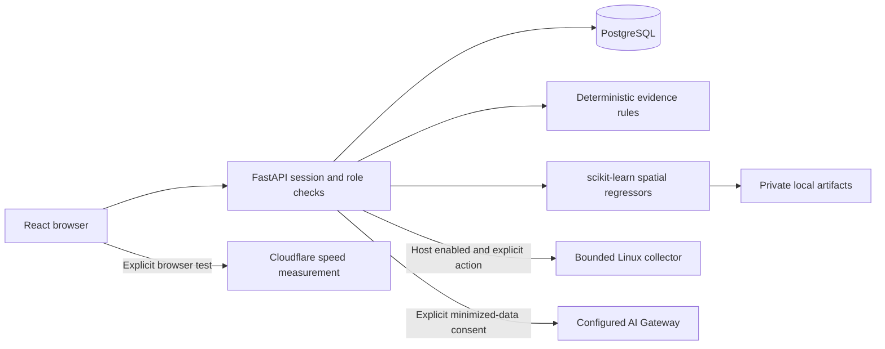

# AirGrid current architecture — 2026-10-28

React 18/TypeScript/Vite/Tailwind provides the browser application. FastAPI exposes a versioned modular API over SQLAlchemy/PostgreSQL. Authentication uses server-owned sessions, Argon2 passwords, canonical roles (`administrator`, `network_engineer`, `viewer`) and CSRF validation on mutations. Protected floor-plan endpoints retain session authentication.

Application data is `airgrid_db`; tests enforce `airgrid_test_db` before imports and assert the engine target. Alembic head is `0007_network_diagnostics`. This recovery did not apply migrations or alter development measurements.

The existing campus/building/floor hierarchy and protected floor plans support calibrated survey sessions and observations. Survey IDW and ML evaluation now share physical distance, smoothing and support rules. ML persists dataset fingerprints, provenance summaries, evaluation records and model metadata; locally generated joblib artifacts are checked for containment, checksum and sklearn compatibility before verified bytes are deserialized. Test artifacts use temporary directories.

The read-only collector uses fixed `ip`, `iw` and `nmcli` calls, bounded timeout/output, interface validation and no rescan. Backend collection defaults disabled. Gateway probes target only the discovered gateway. iperf requires a configured literal-IP allowlist and serializes tests within a process. PostgreSQL diagnostic reports, telemetry snapshots and findings preserve timestamps and source attribution. Browser round-tripped snapshots are operator-reported, not trusted instrument evidence.

The Analyst reloads an authenticated saved report and recomputes deterministic findings. It does not transmit data by default. An explicitly requested AI pass receives only minimized numeric findings and IDs. The only accepted model output is a list of known IDs; all deterministic findings remain visible. Direct AI generation is authenticated, role/CSRF-protected and requires explicit consent. Provider identity is self-reported; health checks are explicit and configuration is not represented as availability.

Optimization uses authenticated read-only floor/network survey queries, excludes controlled imports/estimates and labels operator evidence. A coarse 4×4 sampling grid identifies missing observations, not coverage. Weak RSSI thresholds produce measurement recommendations and source references. Candidate notes/normalized AP markers stay in browser memory and export separately from evidence; they never mutate infrastructure or survey data.

No automation product module, public dispatch-test endpoint, workflow builder, background collection, scheduled probing or router-control execution is enabled. Legacy signing/simulation code remains internal. Older design specifications are historical, particularly the retired automation design.

Open scope: collector registration/identity and trusted ingestion, shared cross-worker rate/concurrency limits, retention controls, historical telemetry charts, temporal/session validation refinements, persisted candidate plans, and reports spanning speed history, heatmaps, ML and multiple sessions. Current diagnostic reports must not be treated as causal proof or full coverage certification. Browser fixture screenshots verify UI behavior, not physical network conditions.
