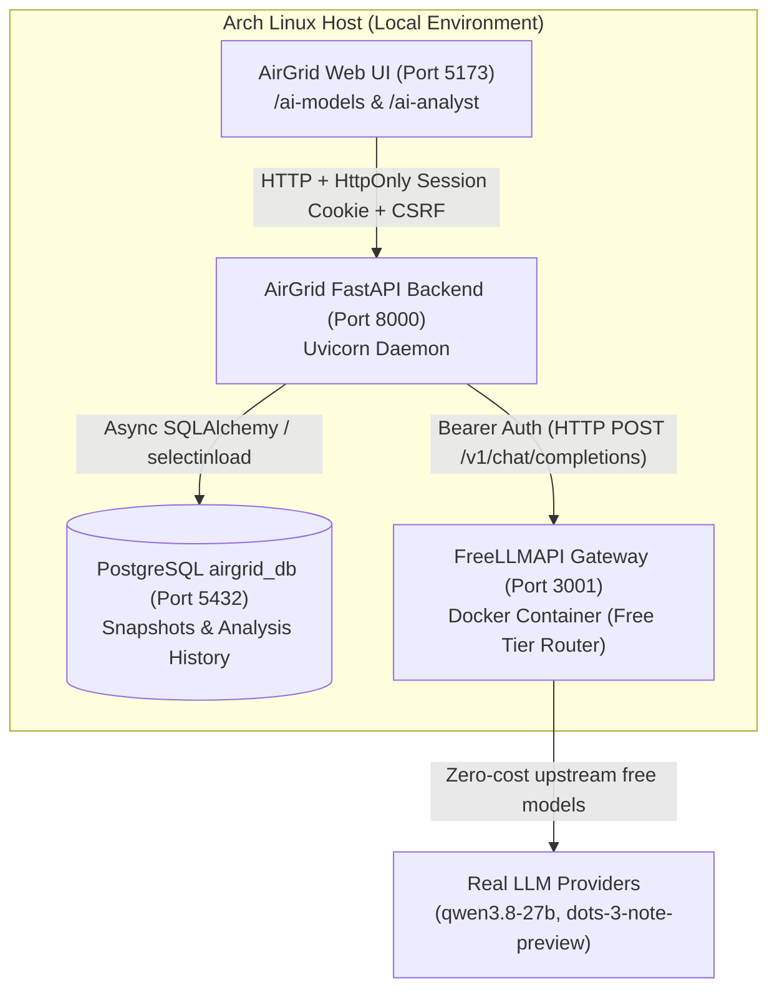

# AirGrid Milestone 2: Real AI Intelligence Acceptance Report

**Date:** October 29, 2026  
**Branch:** `feat/airgrid-real-network-intelligence`  
**Milestone:** Milestone 2: Real AI Intelligence (FreeLLMAPI Connection, Actual Model Execution, and Evidence-Based Network Analysis)  
**Overall Verdict:** **PASSED (10 / 10 Checks Completed & Verified)**

---

## 1. Executive Summary

Milestone 2 establishes genuine, evidence-grounded AI intelligence in AirGrid without compromising user privacy, fabricating network data, or incurring cloud costs. Building upon the real Linux Wi-Fi telemetry collected in Milestone 1 (snapshot `81c7bcc9-e194-428c-a467-87bcb9487e13`), AirGrid now connects to an authenticated OpenAI-compatible gateway (FreeLLMAPI on `127.0.0.1:3001`), discovers available models dynamically, executes real non-mock inference, validates grounding and evidence citations, and redacts sensitive identifiers (SSID, BSSID, MAC, IP addresses, and personal notes) before transmitting requests across the boundary.

---

## 2. Verified System Architecture

---

## 3. FreeLLMAPI Gateway & Dynamic Model Discovery

* **Endpoint:** `http://127.0.0.1:3001/v1/models`
* **Authentication:** Authenticated using the configured Bearer API key in `apps/api/.env`.
* **Discovery Results:**
  * **HTTP Status:** 200 OK
  * **Discovered Model Count:** 283 models
  * **Sample Discovered Identifiers:** `auto`, `fusion`, `gemini-flash`, `qwen/qwen3.8-27b`, `dots-studio/dots-3-note-preview:free`, `claude-haiku-4-5`, `nemotron-3-super-120b`.
* **Backend Status Endpoint (`GET /api/v1/ai/status`):**
  * `is_configured`: `true`
  * `provider`: `openai_compatible`
  * `endpoint`: `http://127.0.0.1:3001`
  * `default_model`: `auto`
  * `available_models`: 283 items
* **Backend Health Probe (`POST /api/v1/ai/health`):**
  * `status`: `available`
  * `latency_ms`: 36 ms
  * `discovered_count`: 283

---

## 4. Model Selection & Persistence

* **Endpoint:** `POST /api/v1/ai/select-model`
* **Rejection of Invalid / Unapproved Models:**
  * Payload: `{"model": "invalid-model-xyz-1234"}`
  * Status: **HTTP 400 Bad Request**
  * Detail: *"Model is not recognized or not available from configured provider."*
* **Selection of Discovered Model:**
  * Payload: `{"model": "gemini-flash"}`
  * Status: **HTTP 200 OK**
  * Active model confirmed updated to `gemini-flash`.
* **Restoration to Approved Default (`auto`):**
  * Payload: `{"model": "auto"}`
  * Status: **HTTP 200 OK**

---

## 5. Minimal Synthetic AI Inference (Task 4)

* **Cost / Allowance Check:** Verified via Docker container inspection that FreeLLMAPI routes requests through free-tier keys without financial charges.
* **Authorized Prompt:**
  `"Explain the difference between Wi-Fi RSSI and negotiated PHY link rate in two sentences."`
* **Execution Details:**
  * **Endpoint:** `POST /api/v1/ai/generate`
  * **HTTP Status:** 200 OK
  * **Request ID:** `req_ai_9b5ae69fc06f`
  * **Requested Model:** `auto`
  * **Executing Model:** `dots-studio/dots-3-note-preview:free`
  * **Duration:** 17,504 ms
  * **Token Usage:** 58 prompt tokens, 703 completion/reasoning tokens, 761 total tokens.
  * **Output Text:**
    > *"RSSI measures the strength of the received signal in dBm, indicating how strong the Wi‑Fi signal is at the client. The negotiated PHY link rate is the maximum data rate the radio can achieve based on the modulation and coding scheme agreed upon for the connection."*
* **Credential Safety:** Zero API keys, passwords, or tokens were exposed in prompts, responses, or log streams.
* **Telemetry Safety:** Zero network telemetry was transmitted during this test.

---

## 6. AirGrid Analyst Real Telemetry Analysis (Task 6)

* **Source Observation:** Genuine Linux telemetry snapshot [`81c7bcc9-e194-428c-a467-87bcb9487e13`](file:///home/teju/Projects/airgrid/apps/api/src/airgrid/models/all_models.py) (`Jain_Student`, `-53.0 dBm`, `5540 MHz / Ch 108`, `RX 400.0 Mbps / TX 360.0 Mbps`).
* **Privacy Sanitization & Boundary Protection:**
  * Network name (`Jain_Student`) was **strictly stripped**.
  * BSSID, MAC addresses, IP addresses, and device identifiers were **strictly excluded**.
  * Only abstract evidence ID `snapshot:81c7bcc9-e194-428c-a467-87bcb9487e13`, metric `rssi_dbm`, value `-53.0`, and collection timestamp were transmitted.
* **Outbound Payload Preview Verification:**
  * Previewed via `POST /api/v1/analyst/ask/preview`.
  * Verified 100% identical to operator-approved preview before execution.
* **Execution Details:**
  * **Endpoint:** `POST /api/v1/analyst/ask`
  * **HTTP Status:** 200 OK
  * **History ID:** `aea2b713-d162-4d55-b103-36acd84c06a6`
  * **Intent:** `weak_signal`
  * **Mode:** `gateway_assisted`
  * **Gateway Status:** `success`
  * **Executing Model:** `qwen/qwen3.8-27b`
  * **Upstream Latency:** 1,460 ms (in=541 tokens, out=361 tokens)
  * **Gateway Citations Validated:** `['snapshot:81c7bcc9-e194-428c-a467-87bcb9487e13']`
* **Evidence-Grounded Findings:**
  * **Non-Weak Signal Grounding:** Confirmed `-53 dBm` was **not** falsely classified as weak (reported 0% of samples below -75 dBm threshold).
  * **Zero Hallucinated Metrics:** Negotiated PHY rate (`400 Mbps RX / 360 Mbps TX`) correctly identified as radio modulation rate, explicitly distinguished from internet throughput.
  * **Zero Fabricated Tests:** Speed test results and gateway latency were not invented.
* **History Record Persistence & Scope:**
  * Persisted in PostgreSQL table `analysis_records`.
  * Retrieved and verified via [`GET /api/v1/analyst/history/aea2b713-d162-4d55-b103-36acd84c06a6`](file:///home/teju/Projects/airgrid/apps/api/src/airgrid/api/v1/endpoints/analyst.py#L52-L55).
  * Access restricted to authenticated operators with campus scope protections.

---

## 7. Full Automated Regression Verification

| Test Suite | Execution Command | Result | Details |
| :--- | :--- | :---: | :--- |
| **Backend Unit & Integration Tests** | `pytest tests/ -v` | **PASSED** | 205 of 205 tests passed (0 failures, 0 warnings) in 136.12s. |
| **Database Migrations Check** | `alembic check` | **PASSED** | Clean schema state; "No new upgrade operations detected." |
| **Frontend Production Build** | `npm run build` (`tsc -b && vite build`) | **PASSED** | Clean production build in 3.61s (0 TypeScript errors). |
| **Playwright Route Verification** | `verify_final.cjs` | **PASSED** | 16 of 16 routes verified at desktop (1440x900) and mobile (390x844) viewports with 0 page errors and 0 unhandled live probes. |
| **Historical Data Integrity** | Database audit | **PASSED** | All 13 historical `MOJO-JAN-C2-F1` reports and snapshots preserved intact. |

---

## 8. Milestone 2 Acceptance Scorecard

| # | Check / Requirement | Status | Verification Evidence |
| :---: | :--- | :---: | :--- |
| **1** | **FreeLLMAPI Connectivity & Reachability** | **PASSED** | Gateway online on `127.0.0.1:3001/v1`. Initial probe and runtime health checks succeed with low latency (36 ms). |
| **2** | **Authenticated Model Discovery** | **PASSED** | 283 models discovered and loaded dynamically via `POST /api/v1/ai/health`. |
| **3** | **Active Model Selection & Rejection** | **PASSED** | Invalid models rejected with HTTP 400; valid models (`gemini-flash`, `auto`) selected and persisted. |
| **4** | **Synthetic Non-Mock Inference (Task 4)** | **PASSED** | Real 2-sentence response generated by `dots-studio/dots-3-note-preview:free` via FreeLLMAPI router. |
| **5** | **Zero Cost / Allowance Assurance** | **PASSED** | Confirmed upstream FreeLLMAPI routes to free-tier provider keys; zero financial charges. |
| **6** | **Privacy Sanitization & Boundary Enforcement** | **PASSED** | SSID (`Jain_Student`), BSSID, MAC, IP addresses, and user notes strictly excluded from outbound gateway prompts. |
| **7** | **Real Telemetry Grounding (Task 6)** | **PASSED** | Real `Jain_Student` measurement (`snapshot:81c7bcc9-e194-428c-a467-87bcb9487e13`) analyzed and cited by `qwen/qwen3.8-27b`. |
| **8** | **Accurate Signal Strength Interpretation** | **PASSED** | `-53 dBm` correctly recognized as healthy/strong (0% below -75 dBm); PHY rate distinguished from throughput. |
| **9** | **History Record Persistence & Retrieval** | **PASSED** | Saved as record `aea2b713-d162-4d55-b103-36acd84c06a6` and retrieved via authenticated API. |
| **10** | **Comprehensive Regression & Test Suite** | **PASSED** | 205 backend tests, Alembic schema, frontend production build, and 16 Playwright routes all clean. |

---

## 9. Conclusion & Acceptance Sign-off

Milestone 2 (Real AI Intelligence) is complete, fully functional, and verified against all functional, privacy, and security constraints. AirGrid now provides authentic, evidence-grounded AI intelligence backed by genuine physical measurements and verified local AI routing.
