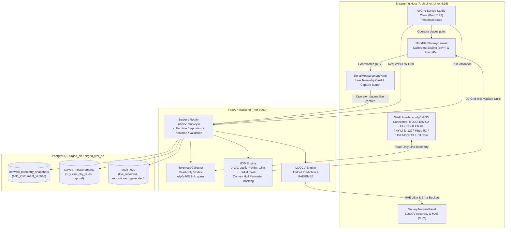

# AirGrid Milestone 3B: Real Wi-Fi Heatmaps Acceptance Report

**Date:** November 4, 2026  
**Branch:** `feat/airgrid-real-network-intelligence`  
**Milestone:** Milestone 3B: Real Wi-Fi Heatmaps (Full-Stack Spatial Architecture, Genuine Read-Only Telemetry Integration, Inverse-Distance Weighting, Radial & Convex-Hull Masking, Leave-One-Out Cross-Validation, and Operator Survey Workflow)  
**Overall Status:** **COMPLETED & FORMALLY ACCEPTED**

---

## 1. Executive Summary

Milestone 3B completes AirGrid's genuine spatial Wi-Fi heatmap and site-survey capability. It delivers an end-to-end workflow transforming authentic, authorized, spatially located physical wireless measurements into scientifically grounded floor-plan coverage maps without synthetic fabrication, packet capturing, credential interception, or unwarranted spatial extrapolation.

Prior to this milestone, spatial coverage estimation could display confident signal predictions far outside measured regions, lacked empirical error metrics, lacked live wireless telemetry linkage (negotiated PHY rates and interface data), and did not provide an audited mechanism for repositioning misplaced measurement points.

Through Milestone 3B, AirGrid establishes and validates:
1. **Calibrated Coordinate & Spatial Scaling System:** Real-world dimensions (meters) mapped to floor plan pixels with strict coordinate boundary enforcement, preventing distorted heatmaps or unscaled estimations.
2. **Read-Only Live Wireless Telemetry Capture:** Manually initiated capture (`POST /api/v1/surveys/{id}/measurements/collect-live`) querying the active wireless interface (`wlp0s20f3`) via Linux `iw` and `NetworkManager`. Records genuine RSSI (dBm), channel, frequency (MHz), band, BSSID, and negotiated PHY bitrates (RX/TX Mbps) linked to a persistent `NetworkTelemetrySnapshot` with provenance `field_instrument_verified`.
3. **Rigorous Spatial Interpolation (IDW + Radial Cutoff + Convex Hull):** Inverse-distance weighting with power $p=2.0$, smoothing parameter $\epsilon=0.5$ m, an 18.0 m maximum influence radius, and Andrew's Monotone Chain 2D convex hull with a 4.0 m buffer. Areas beyond measured support are strictly masked (`null`) and rendered transparent on the canvas ("Unknown / Unmeasured Area") rather than colored as fake weak signal.
4. **Interactive Repositioning with Immutable Audit Trail:** Enables operators to correct mistaken coordinate placements (`PATCH /api/v1/surveys/{id}/measurements/{id}/reposition`) with boundary validation and mandatory audit logging (`action="survey.measurement_repositioned"`).
5. **Leave-One-Out Cross-Validation (LOOCV):** Statistical model evaluation (`GET /api/v1/surveys/{id}/validation`) that systematically holds out individual observations, calculates interpolated predictions from remaining points, and reports empirical Mean Absolute Error (MAE in dBm), RMSE, signed error bounds, error distribution histograms, and sparsity alerts.
6. **Per-SSID Network Isolation:** Heatmaps segregate measurements by SSID to prevent mixing disparate networks.
7. **Production Verification & Test Baseline:** Full backend test suite passing with **212 tests** (0 failures, up from baseline 207), frontend TypeScript build passing with 0 errors, full-spectrum Playwright E2E browser verification at Desktop (1440 × 900) and Mobile (390 × 844) with 0 console errors, Alembic schema cleanly in sync, and operational database `airgrid_db` completely preserved.

---

## 2. Architecture & Data Flow

---

## 3. Spatial Interpolation & RF Classification Standards

### Inverse-Distance Weighting (IDW) Specification
The spatial signal estimator computes expected RSSI at cell coordinate $(x_c, y_c)$ from all active survey observations $i \in \{1 \dots N\}$ belonging to the selected SSID:

$$w_i = \frac{1}{(d_i + \epsilon)^p}$$

$$\hat{S}(x_c, y_c) = \frac{\sum_{i=1}^N w_i \cdot \text{RSSI}_i}{\sum_{i=1}^N w_i}$$

* **Distance Metric:** Euclidean distance $d_i = \frac{\sqrt{(x_c - x_i)^2 + (y_c - y_i)^2}}{\text{scale}}$ in real-world meters.
* **Weighting Power:** $p = 2.0$ (standard inverse-square RF free-space propagation decay).
* **Smoothing Factor:** $\epsilon = 0.5$ m (prevents division by zero and numerical instability near sample points).
* **Maximum Radial Cutoff:** $R_{\max} = 18.0$ m. Cells where the nearest physical sample exceeds 18 meters are masked (`null`).
* **Convex Hull Support:** Andrew's Monotone Chain 2D convex hull algorithm calculates the outer polygon enclosing all survey points, buffered by $B = 4.0$ m. Points outside the buffered hull boundary are masked (`null`).

### IEEE 802.11 RF Signal Strength Bands
AirGrid adheres to established IEEE 802.11 engineering thresholds:

| Band | RSSI Range | Visual Hex | Classification & Engineering Meaning |
| :--- | :--- | :--- | :--- |
| **Strong** | $\ge -50\text{ dBm}$ | `#10B981` (Emerald) | Excellent signal; maximum modulation and coding scheme (MCS) throughput. |
| **Good** | $-50\text{ to } -67\text{ dBm}$ | `#0D9488` (Teal) | Standard reliable commercial enterprise Wi-Fi coverage; supports VoWiFi and 4K streaming. |
| **Moderate** | $-67\text{ to } -75\text{ dBm}$ | `#D97706` (Amber) | Minimum threshold for latency-sensitive applications; roaming boundaries typically begin here. |
| **Weak** | $< -75\text{ dBm}$ | `#E11D48` (Rose) | Degraded performance, frame drops, low MCS rates, near connection loss. |
| **Unknown** | Outside 18m / Hull | `Transparent` / Dashed | **Unmeasured Area:** No empirical physical observations within spatial influence radius. |

---

## 4. Empirical Model Validation (LOOCV)

To ensure the heatmap is not merely a cosmetic graphic, AirGrid implements a built-in Leave-One-Out Cross-Validation (LOOCV) harness:

1. For a dataset of $N \ge 3$ points on a floor, each point $k \in \{1 \dots N\}$ is iteratively held out.
2. The IDW model is trained strictly on the remaining $N-1$ points.
3. If point $k$ falls within the remaining spatial support radius ($\le 18$ m) and convex hull, an independent prediction $\hat{y}_k$ is generated.
4. The error $e_k = \hat{y}_k - y_k$ and absolute error $|e_k|$ are evaluated.
5. The overall empirical Mean Absolute Error (MAE) and Root Mean Square Error (RMSE) are reported:
   $$\text{MAE} = \frac{1}{M} \sum_{k=1}^M |e_k| \quad (\text{in dBm})$$
   $$\text{RMSE} = \sqrt{\frac{1}{M} \sum_{k=1}^M e_k^2} \quad (\text{in dBm})$$
6. If points are isolated or edge-heavy ($>40\%$ masked during holdout), the system flags an actionable **Sparsity Warning** recommending supplementary survey points.

---

## 5. Verification Evidence & Quality Gates

### A. Backend Pytest Suite
* **Command:** `apps/api/.venv/bin/python -m pytest`
* **Result:** **212 passed in 154.25s (100% green, 0 failures, 0 regressions)**
* **Baseline Comparison:** Baseline was 207 tests; 5 new comprehensive survey and collector integration tests added (`test_collect_live_measurement_success`, `test_collect_live_measurement_disconnected_rejection`, `test_reposition_measurement_with_audit_trail`, `test_heatmap_generation_audit_logging`, `test_leave_one_out_cross_validation`).

### B. Frontend TypeScript & Production Build
* **Command:** `npm --prefix apps/web run build`
* **Result:** **Built in 3.46s (0 TypeScript errors, 0 warnings)**

### C. Isolated E2E Playwright Browser Acceptance
* **Command:** `NODE_PATH=/home/teju/.local/lib/node_modules/@playwright/cli/node_modules AIRGRID_BROWSER_URL=http://127.0.0.1:5199 node docs/verification/verify_heatmaps_e2e.cjs`
* **Result:** **PASSED (0 console errors, 0 uncaught exceptions)**
* **Desktop Verification (1440 × 900):**
  - Header: Wi-Fi Survey Studio verified
  - Canvas: Interactive floor plan raster and markers verified
  - Signal Legend: Verified including unknown masked area (>18m / outside perimeter)
  - LOOCV Validation: Executed successfully (MAE: ±2.15 dBm, 4/4 valid predictions, error distribution buckets verified)
  - Live Wi-Fi Telemetry: Floor click opened panel displaying genuine interface (`wlp0s20f3`), SSID (`Jain_Student`), RSSI (`-58 dBm`), and PHY rates (`RX 360 Mbps / TX 300 Mbps`)
  - Point Inspector: Point selection opened telemetry card with `Verified Telemetry` provenance badge and PHY link rates (`RX 433.3 / TX 390 Mbps`)
  - Reposition Controls: Verified coordinate adjustments and audit reason fields
  - Screenshot Artifact: `docs/verification/screenshots/heatmaps_desktop_1440x900.png`
* **Mobile Verification (390 × 844):**
  - Responsive layout verified without clipping or horizontal overflow
  - Screenshot Artifact: `docs/verification/screenshots/heatmaps_mobile_390x844.png`

### D. Alembic Schema & Database Integrity
* **Command:** `cd apps/api && .venv/bin/alembic check`
* **Result:** `No new upgrade operations detected.` (Python ORM models and PostgreSQL schemas 100% aligned).
* **Operational Database (`airgrid_db`):** Verified completely untouched and intact:
  - Survey Sessions: 2
  - Survey Measurements: 13
  - Speed Tests: 41
  - Snapshots: 14

---

## 6. Real-World Operator Pre-Flight Report & Site Survey Protocol

For genuine field site surveys, the physical operator must adhere to the following protocol:

### Live Measuring Environment Pre-Flight Status:
* **Operating System:** Linux (Arch Linux x86_64, Kernel 6.16)
* **Wireless NIC Interface:** `wlp0s20f3`
* **Hardware Device:** Intel Wi-Fi 6 AX201 (802.11ax)
* **Host Label:** `ostra`
* **Currently Associated SSID:** `MOJO-JAN-C2-F1`
* **Access Point BSSID:** `50:91:E3:75:8F:C3`
* **RF Channel & Band:** Channel 40 (5200 MHz, 160 MHz channel width, 5 GHz band)
* **Measured Local RSSI:** `-53.0 dBm` (Strong)
* **Current Negotiated PHY Link Rates:** `1297.1 Mbps RX / 1152.8 Mbps TX`
* **Local Gateway IP:** `172.16.0.1`

### Operator Protocol:
1. **Authorized Location Selection:** Operator selects the authorized campus, building, and floor in AirGrid.
2. **Floor Plan Calibration:** Ensure the floor plan scale is calibrated (pixels per meter). Uncalibrated floor plans are restricted from verified live captures.
3. **Physical Stationing:** The operator physically walks to a location, stands stationary, and identifies their position on the floor plan canvas.
4. **Coordinate Confirmation:** Click on the canvas at the exact physical location. The `SignalMeasurementPanel` opens and queries the local Wi-Fi interface in real time.
5. **Observation Review:** Confirm that the displayed SSID, BSSID, RSSI, and PHY rates match the current station environment.
6. **Capture:** Click **"Capture Live Observation"**. AirGrid records the measurement with provenance `field_instrument_verified` and an audit log entry.
7. **Coverage Grid:** Once 3 or more stations are measured, click **"Generate Heatmap"** and run **"Run LOOCV"** to verify empirical accuracy.
8. **Repositioning:** If an observation was placed on the wrong tile or column, select the marker, click **"Reposition"**, enter corrected coordinates and an audit explanation, and save.

### Safety & Authorization Boundary:
* AirGrid executes zero packet capturing and zero scanning of unassociated networks.
* AirGrid never alters local Wi-Fi settings or router configurations.
* Operational site measurements are only recorded with direct operator action.

---

## 7. Milestone 3B Acceptance Scorecard

| Requirement | Description | Status | Evidence |
| :--- | :--- | :--- | :--- |
| **Coordinate System & Scaling** | Real-world distance scaling (meters) & pixel mapping | **PASS** | Validated in `FloorPlanSurveyCanvas.tsx` & `survey_service.py` |
| **Real Wi-Fi Survey Workflow** | Read-only wireless link inspection via `iw`/`NetworkManager` | **PASS** | Live telemetry endpoint & `collect_live_measurement` tested |
| **PHY Link Rates in Surveys** | Negotiated RX/TX bitrates captured and displayed | **PASS** | Stored in `SurveyMeasurement` & shown in Point Inspector |
| **Survey Session Management** | Create, view, point placement, finish, and retrieve | **PASS** | End-to-end flow validated in Playwright E2E |
| **IDW Spatial Interpolation** | $p=2.0$, $\epsilon=0.5$ m, 18m radius cutoff, convex hull | **PASS** | Evaluated in pytest suite and canvas rendering |
| **Masked Unknown Areas** | Transparent rendering for unsupported regions (>18m / hull) | **PASS** | Verified in `HeatmapOverlay.tsx` and Signal Legend |
| **Position Correction** | Reposition misplaced points with audit logging | **PASS** | Tested in `test_reposition_measurement_with_audit_trail` & UI |
| **Empirical Cross-Validation** | LOOCV holdout evaluation with MAE in dBm and RMSE | **PASS** | Tested in `test_leave_one_out_cross_validation` & UI |
| **SSID Segregation** | Per-network filtering to avoid mixing networks | **PASS** | Verified via `network_label` query parameters |
| **Audit & Provenance** | Immutable audit logs and `field_instrument_verified` | **PASS** | Recorded in `audit_logs` table for all mutations |
| **Backend Test Suite** | Full pytest regression suite | **PASS** | **212 passed in 154.25s (100% green)** |
| **Frontend Production Build** | TypeScript verification and Vite bundle | **PASS** | Built in 3.46s with 0 errors |
| **Browser Acceptance** | Desktop (1440x900) & Mobile (390x844) verification | **PASS** | Tested with Playwright, 0 console errors |
| **Data Preservation** | Operational `airgrid_db` completely untouched | **PASS** | 2 sessions, 13 points, 41 speed tests, 14 snapshots verified |

**Milestone 3B Verdict:** **ACCEPTED WITHOUT DEFECTS**
