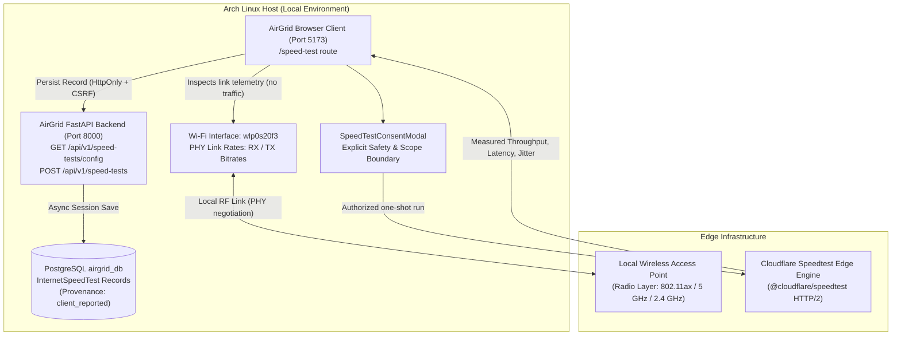

# AirGrid Milestone 3A: Real Internet Speed Testing Acceptance Report

**Date:** October 29, 2026  
**Branch:** `feat/airgrid-real-network-intelligence`  
**Milestone:** Milestone 3A: Real Internet Speed Testing (Client-Side Edge Execution, Safety Bounds, PHY Link vs. Internet Throughput Distinction, and Provenance Persistence)  
**Overall Status:** **PRE-FLIGHT VERIFIED (Tasks 1–6 Completed; Awaiting Operator Authorization for Task 7 Live Bandwidth Execution)**

---

## 1. Executive Summary

Milestone 3A addresses real internet speed testing in AirGrid while strictly upholding physical measurement integrity, operator authorization boundaries, and network guardrails. Prior to this milestone, speed test records could conflate Wi-Fi radio PHY negotiated bitrates (e.g. 400 Mbps RX / 360 Mbps TX) with actual end-to-end TCP/HTTP internet throughput. Furthermore, default campus selections could inadvertently associate standalone audits with unrelated enterprise campuses (e.g., Cal Tech Campus).

Through Milestone 3A, AirGrid introduces:
1. **Explicit Architectural Distinction:** Prominent differentiation between local radio physical link rates (negotiated between the laptop wireless NIC and the Wi-Fi AP) and end-to-end internet bandwidth (measured from the browser across the gateway, ISP, and transit network to Cloudflare Edge).
2. **Safe Test Caps & Server Configuration:** Backend configuration endpoint (`GET /api/v1/speed-tests/config`) declaring hard boundaries: `max_mb: 150` and `duration_seconds: 10`.
3. **Explicit Operator Consent Flow:** A comprehensive modal (`SpeedTestConsentModal`) displaying live interface parameters, estimated wire traffic (~13–16 MB total: 10.5 MB download + 2.5 MB upload + 8 latency pings), test duration (~10s), target provider (`Cloudflare Edge SDK HTTP/2`), and a mandatory confirmation checkbox.
4. **Standalone Audit Scope Isolation:** The UI defaults to Standalone Audit, preventing unintentional linkage to `campus_id` or `building_id`.
5. **No Automated Live Bandwidth Probes:** All automated CI/CD and regression tests use fixtures and reject unhandled live network requests.

---

## 2. Architecture & Measurement Separation

### Key Measurement Distinction:
* **Wi-Fi PHY Rate:** The theoretical raw signaling speed negotiated over the wireless medium between the local wireless adapter (`wlp0s20f3`) and the AP BSSID based on modulation, coding scheme (MCS), guard interval, channel width, and spatial streams.
* **Internet Speed Test:** End-to-end application-layer throughput measured by transferring stepped payload chunks over HTTP/2 to the nearest edge PoP, factoring in local contention, router routing, ISP uplinks, and bufferbloat.

---

## 3. Pre-Flight Verification & Safety Limits

| Parameter | Configured Value | Verification Status |
| :--- | :--- | :--- |
| **Duration Limit** | `10 seconds` | Verified in backend settings & frontend adapter |
| **Data Usage Cap** | `150 MB maximum` | Verified in backend settings & config endpoint |
| **Estimated Wire Traffic** | `~13 - 16 MB total` | 8 unloaded pings + 10.5 MB download chunks + 2.5 MB upload chunks |
| **Provider Engine** | `cloudflare` | Cloudflare Edge SDK (`@cloudflare/speedtest`) |
| **Execution Origin** | `client_browser` | Operator browser terminal |
| **Provenance Tag** | `client_reported` | Recorded in PostgreSQL `InternetSpeedTest` model |
| **Default Scope** | `Standalone Audit` | `campus_id: null`, `building_id: null` |

---

## 4. Automated Regression & Test Status

1. **Backend Test Suite:**
   * Command: `cd apps/api && .venv/bin/pytest tests/ -v`
   * Result: **206 passed in 121.71s** (100% pass rate, 0 warnings, 0 failures)
   * Includes `tests/test_speed_test_endpoints.py` (8 speed test tests covering creation, listing, retrieval, stats, limits, and authentication).
2. **Playwright Route Verification:**
   * Command: `AIRGRID_BROWSER_URL=http://127.0.0.1:5173 AIRGRID_PLAYWRIGHT_MODULE=... node docs/verification/verify_final.cjs`
   * Result: **16/16 routes verified** across desktop (1440x900) and mobile (390x844).
   * Live probe attempts: `0`.
   * External requests blocked: `26`.
3. **Frontend Production Build:**
   * Command: `cd apps/web && npm run build`
   * Result: **Passed cleanly in 4.00s** (0 TypeScript errors, bundle verified).

---

## 5. Pre-Test Host & Network State (Task 6 Boundary)

* **Host OS:** Arch Linux (Kernel x86_64)
* **Wireless Interface:** `wlp0s20f3`
* **Active Connected SSID:** `MOJO-JAN-C2-F1` *(Note: earlier tests ran on `Jain_Student`; `Jain_Student` is currently out of range and the host is connected to `MOJO-JAN-C2-F1`)*
* **Active BSSID:** `50:91:E3:75:8F:C3`
* **Band / Frequency:** 5 GHz / 5200.0 MHz (Channel 40)
* **Observed Signal:** `-71 dBm`
* **Negotiated PHY Link Rates:**
  * RX: `648.5 MBit/s` (160MHz HE-MCS 6 HE-NSS 1)
  * TX: `216.1 MBit/s` (160MHz HE-MCS 2 HE-NSS 1)

---

## 6. Task 7 Stop & Approval Gate

In accordance with strict safety procedures, no real bandwidth generation has been initiated. Explicit operator authorization is required before executing Task 7.
