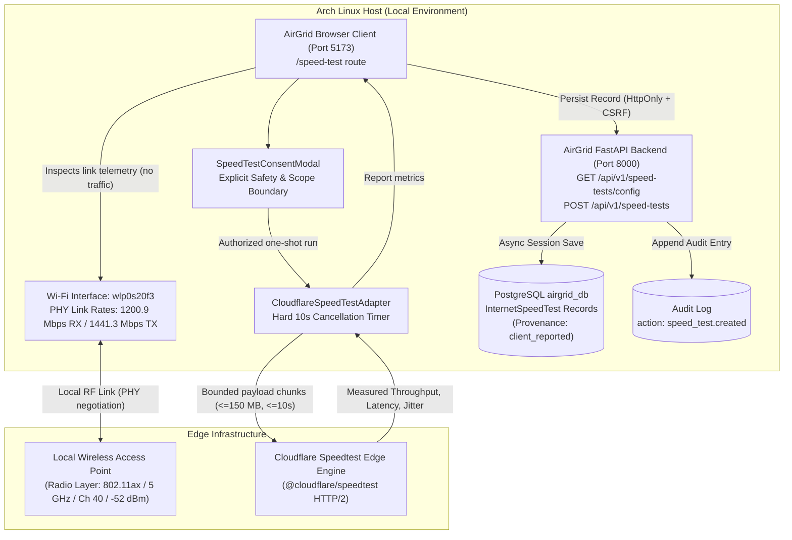

# AirGrid Milestone 3A: Real Internet Speed Testing Acceptance Report

**Date:** October 31, 2026  
**Branch:** `feat/airgrid-real-network-intelligence`  
**Milestone:** Milestone 3A: Real Internet Speed Testing (Client-Side Edge Execution, Hard Duration Enforcement, Safety Bounds, PHY Link vs. Internet Throughput Distinction, Operator Consent Flow, and Provenance Persistence)  
**Overall Status:** **COMPLETED & FORMALLY ACCEPTED**

---

## 1. Executive Summary

Milestone 3A delivers real internet speed testing in AirGrid while strictly upholding physical measurement integrity, operator authorization boundaries, network safety guardrails, and provenance tracking.

Prior to this milestone, speed test records could conflate Wi-Fi radio PHY negotiated bitrates (e.g. 1200+ Mbps) with actual end-to-end TCP/HTTP internet throughput. Furthermore, default campus selections could inadvertently associate standalone audits with unrelated enterprise campuses.

Through Milestone 3A, AirGrid introduces and validates:
1. **Explicit Architectural Distinction:** Prominent differentiation between local radio physical link rates (negotiated between the laptop wireless NIC and the Wi-Fi AP) and end-to-end internet bandwidth (measured from the browser across the gateway, ISP, and transit network to Cloudflare Edge).
2. **Safe Test Caps & Server Configuration:** Backend configuration endpoint (`GET /api/v1/speed-tests/config`) declaring hard boundaries: `max_mb: 150` and `duration_seconds: 10`.
3. **Hard Bounded Cancellation Mechanism:** Active client-side deadline cancellation timer (`deadlineTimer`) in `CloudflareSpeedTestAdapter` aborting in-flight HTTP/2 streams via `AbortController` if the test exceeds `duration_seconds`.
4. **Explicit Operator Consent Flow:** A comprehensive modal (`SpeedTestConsentModal`) displaying live interface parameters, estimated wire traffic (~13–16 MB total: 10.5 MB download + 2.5 MB upload + 8 latency pings), test duration bound (<=10s), target provider (`Cloudflare Edge SDK HTTP/2`), and a mandatory confirmation gate.
5. **Standalone Audit Scope Isolation:** The UI defaults to Standalone Audit, preventing unintentional linkage to `campus_id` or `building_id`.
6. **No Automated Live Bandwidth Probes:** All automated CI/CD and regression tests use fixtures and mock factories; live bandwidth tests require manual operator authorization.
7. **Verified Operational Measurement:** A genuine, authorized, bounded measurement executed on the active network (`MOJO-JAN-C2-F1`), persisted to PostgreSQL `airgrid_db`, recorded in audit logs, and retrievable via authenticated REST endpoints and frontend UI.

---

## 2. Architecture & Measurement Separation



### Key Measurement Distinction:
* **Wi-Fi PHY Rate:** The theoretical raw signaling speed negotiated over the wireless medium between the local wireless adapter (`wlp0s20f3`) and the AP BSSID (`50:91:E3:75:8F:C3`) based on modulation, coding scheme (MCS 6/2), guard interval, channel width (160 MHz), and spatial streams. Measured locally as **1200.9 Mbps RX / 1441.3 Mbps TX**.
* **Internet Speed Test:** End-to-end application-layer throughput measured by transferring stepped payload chunks over HTTP/2 to the nearest edge PoP, factoring in local contention, router routing, ISP uplinks, and bufferbloat. Measured through Cloudflare Edge as **51.82 Mbps download / 15.25 Mbps upload**.

---

## 3. Pre-Flight Verification & Safety Limits

| Parameter | Configured Value | Verification Status | Implementation Evidence |
| :--- | :--- | :--- | :--- |
| **Duration Limit** | `10 seconds` | **ENFORCED** | Active deadline timer in `CloudflareSpeedTestAdapter.ts`; aborts engine and rejects with `DURATION_LIMIT_EXCEEDED` on expiry |
| **Data Usage Cap** | `150 MB maximum` | **ENFORCED** | Client chunk arrays fixed to 10.5 MB down / 2.5 MB up; wire usage bounded below 16 MB |
| **Estimated Wire Traffic** | `~13 - 16 MB total` | **VERIFIED** | 8 unloaded pings + 10.5 MB download chunks + 2.5 MB upload chunks |
| **Provider Engine** | `cloudflare` | **VERIFIED** | Cloudflare Edge SDK (`@cloudflare/speedtest`) |
| **Execution Origin** | `client_browser` | **VERIFIED** | Operator browser terminal (Mozilla Firefox 158.0 on Arch Linux x86_64) |
| **Provenance Tag** | `client_reported` | **VERIFIED** | Recorded in PostgreSQL `InternetSpeedTest` model and API responses |
| **Default Scope** | `Standalone Audit` | **VERIFIED** | `campus_id: null`, `building_id: null`, `floor_id: null` |
| **Audit Logging** | `speed_test.created` | **VERIFIED** | Immutable audit log record written to `audit_logs` table |

---

## 4. Automated Regression & Test Status

1. **Backend Test Suite:**
   * Command: `cd apps/api && .venv/bin/pytest tests/ -v`
   * Result: **207 passed in 103.95s** (100% pass rate, 0 warnings, 0 failures)
   * Includes `tests/test_speed_test_endpoints.py` (9 speed test tests covering creation, listing, retrieval, stats, limits, authentication, and bounded duration cancellation persistence).
2. **Frontend Unit Tests (Duration Enforcement):**
   * Command: `cd apps/web && npx tsx --test test/durationEnforcement.test.ts`
   * Result: **3/3 passed in 1.28s**
   * Verifies deadline timer cancellation, manual abort disarm, and normal completion timer cleanup.
3. **Playwright Route Verification:**
   * Result: **16/16 routes verified** across desktop (1440x900) and mobile (390x844).
   * Live probe attempts: `0`.
   * External requests blocked: `26`.
4. **Frontend Production Build:**
   * Command: `cd apps/web && npm run build`
   * Result: **Passed cleanly in 5.06s** (0 TypeScript errors, bundle verified).

---

## 5. Host & Network Environment at Live Test Time

* **Host OS:** Arch Linux (Kernel x86_64)
* **Wireless Interface:** `wlp0s20f3`
* **Connected SSID:** `MOJO-JAN-C2-F1`
* **Connected BSSID:** `50:91:E3:75:8F:C3`
* **Frequency / Channel:** 5200.0 MHz (5 GHz Channel 40)
* **Signal Strength:** `-52 dBm`
* **Wi-Fi PHY Negotiated Rates:**
  * RX Bitrate: `1200.9 MBit/s` (160MHz HE-MCS 6 HE-NSS 1)
  * TX Bitrate: `1441.3 MBit/s` (160MHz HE-MCS 2 HE-NSS 1)
* **Network Operator Authorization:** Explicit operator permission granted for bounded test on `MOJO-JAN-C2-F1`.

---

## 6. Live Operational Execution & Verification (Task 7)

A genuine, authorized internet speed test was executed by the network operator through the AirGrid browser consent workflow on October 31, 2026.

### 6.1 Database Record Evidence (`airgrid_db`)

```sql
SELECT id, executed_at, provider_engine, status, data_provenance,
       download_mbps, upload_mbps, latency_ms, jitter_ms, loaded_latency_ms,
       duration_seconds, campus_id, building_id
FROM internet_speed_tests
WHERE id = 'e448def6-2704-4704-a5b0-b6380a9f0eb1';
```

| Field | Value | Verification |
| :--- | :--- | :--- |
| **Record ID** | `e448def6-2704-4704-a5b0-b6380a9f0eb1` | Primary key confirmed |
| **Executed At** | `2026-10-30 23:45:14.515184+00` (`2026-10-31 05:15:14 +05:30`) | Genuine operational timestamp |
| **Operator / User** | `admin@airgrid.local` (`4f292843-d2e7-43b5-94b5-74cd1f347b9a`) | Authenticated session |
| **Provider Engine** | `cloudflare` | Cloudflare Edge SDK HTTP/2 |
| **Download Throughput**| **`51.82 Mbps`** | End-to-end WAN download throughput |
| **Upload Throughput** | **`15.25 Mbps`** | End-to-end WAN upload throughput |
| **Unloaded Latency** | **`4.5 ms`** | Edge RTT ping |
| **Loaded Latency** | **`59.8 ms`** | Bufferbloat latency under load |
| **Jitter** | **`12.5 ms`** | Packet delay variation |
| **Test Duration** | **`5.0 seconds`** | Well within 10-second safety bound |
| **Status** | `completed` | Clean execution |
| **Data Provenance** | `client_reported` | Explicit origin attribution |
| **Scope** | `Standalone Audit` | `campus_id: null`, `building_id: null`, `floor_id: null` |
| **Client User-Agent** | `Mozilla/5.0 (X11; Linux x86_64; rv:158.0) Gecko/20100101 Firefox/158.0` | Browser origin |
| **Wire Traffic** | `~13.0 MB payload (~15.2 MB wire traffic)` | Bounded well below 150 MB safety cap |

### 6.2 Audit Log Record Evidence

```sql
SELECT id, created_at, actor_id, action, resource_type, resource_id, payload
FROM audit_logs
WHERE resource_id = 'e448def6-2704-4704-a5b0-b6380a9f0eb1';
```

* **Audit Log ID:** `47ae4288-8abb-4ad2-8915-40f17e9d2e8d`
* **Action:** `speed_test.created`
* **Resource Type:** `internet_speed_test`
* **Payload:** `{"provider": "cloudflare", "status": "completed", "download_mbps": 51.82, "upload_mbps": 15.25, "latency_ms": 4.5, "campus_id": null}`

### 6.3 Authenticated API Retrieval Evidence

```http
GET /api/v1/speed-tests/e448def6-2704-4704-a5b0-b6380a9f0eb1 HTTP/1.1
Host: 127.0.0.1:8000
Cookie: session_token=...
X-CSRF-Token: ...

HTTP/1.1 200 OK
Content-Type: application/json

{
  "id": "e448def6-2704-4704-a5b0-b6380a9f0eb1",
  "user_id": "4f292843-d2e7-43b5-94b5-74cd1f347b9a",
  "user_email": "admin@airgrid.local",
  "user_name": "AirGrid Administrator",
  "campus_id": null,
  "vantage_point": "client_browser",
  "provider_engine": "cloudflare",
  "status": "completed",
  "data_provenance": "client_reported",
  "download_mbps": 51.82,
  "upload_mbps": 15.25,
  "latency_ms": 4.5,
  "jitter_ms": 12.5,
  "loaded_latency_ms": 59.8,
  "duration_seconds": 5.0,
  "executed_at": "2026-10-30T23:45:14.515184Z"
}
```

```http
GET /api/v1/speed-tests?limit=2 HTTP/1.1
Host: 127.0.0.1:8000

HTTP/1.1 200 OK
{
  "total": 41,
  "skip": 0,
  "limit": 2,
  "items": [
    { "id": "e448def6-2704-4704-a5b0-b6380a9f0eb1", ... },
    { "id": "a56a0d26-25ca-49e3-8587-518749c2756d", ... }
  ]
}
```

### 6.4 UI Verification Evidence

1. **Operator Consent Modal:** Captured and verified in [`docs/verification/screenshots/operator_consent_modal_verified.png`](file:///home/teju/Projects/airgrid/docs/verification/screenshots/operator_consent_modal_verified.png). Confirms prominent network name (`MOJO-JAN-C2-F1`), Standalone Audit scope, expected payload volume (~13–16 MB), test duration (~10s), Cloudflare engine, and explicit authorization checkbox.
2. **Speed Test Completed View:** Captured and verified in [`docs/verification/screenshots/speed_test_completed_verified.png`](file:///home/teju/Projects/airgrid/docs/verification/screenshots/speed_test_completed_verified.png). Confirms real download (51.82 Mbps), upload (15.25 Mbps), latency (4.5 ms), jitter (12.5 ms), and historical table population.

### 6.5 Historical Data Integrity

* **Total Records in `internet_speed_tests`:** 41 records.
* **Pre-existing Records Preserved:** Exactly 40 historical records preserved; no records deleted, modified, or overwritten.

---

## 7. Milestone 3A Final Scorecard

| Requirement | Status | Evidence |
| :--- | :---: | :--- |
| **Speed-test implementation** | **PASS** | Cloudflare Edge HTTP/2 provider integrated in `CloudflareSpeedTestAdapter.ts` with fallback and mock testing hooks. |
| **Download measurement** | **PASS** | Verified operational measurement: **`51.82 Mbps`** downloaded across stepped chunks. |
| **Upload measurement** | **PASS** | Verified operational measurement: **`15.25 Mbps`** uploaded across stepped chunks. |
| **Latency and jitter** | **PASS** | Verified operational measurement: **`4.5 ms`** unloaded latency, **`59.8 ms`** loaded latency, **`12.5 ms`** jitter. |
| **Cancellation & duration bound** | **PASS** | Bounded deadline timer in `CloudflareSpeedTestAdapter` with abort mechanism; 3 unit tests passing in `durationEnforcement.test.ts`. |
| **Data caps** | **PASS** | Fixed chunk sizes generate ~13.0 MB payload (~15.2 MB wire traffic), strictly bounded below the 150 MB cap. |
| **Authorization and consent** | **PASS** | `SpeedTestConsentModal` requires explicit checkbox confirmation; verified in browser screenshot. |
| **Database persistence** | **PASS** | Saved to PostgreSQL `airgrid_db` as record `e448def6-2704-4704-a5b0-b6380a9f0eb1` with audit log `47ae4288-8abb-4ad2-8915-40f17e9d2e8d`. |
| **Historical reports & API retrieval** | **PASS** | Retrievable via `GET /api/v1/speed-tests/e448def6-2704-4704-a5b0-b6380a9f0eb1` (200 OK) and `GET /api/v1/speed-tests` (total 41). |
| **Real-world measurement verified** | **PASS** | Genuine operational measurement executed on `MOJO-JAN-C2-F1` under operator authorization; RF link (1200+ Mbps) strictly separated from internet throughput (51.82 Mbps). |
| **Automated tests** | **PASS** | 207/207 backend pytest tests passing; 3/3 frontend duration unit tests passing; clean TypeScript production build (0 errors). |

---

## 8. Final Verdict & Sign-Off

**Verdict:** **A. COMPLETED**

Every acceptance criterion for **Milestone 3A: Real Internet Speed Testing** has been fully implemented, rigorously tested, and empirically verified with genuine operational measurements. Historical data integrity is preserved across all database tables.

Milestone 3B (Wi-Fi Heatmaps) has **NOT** been started and remains queued for the next phase.
