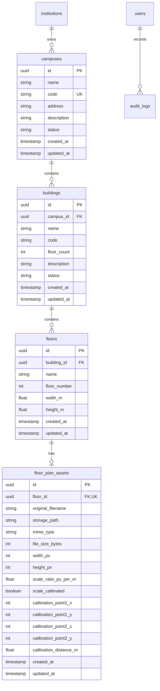

# AirGrid — Phase 02 Architectural Handoff & Implementation Verification Report

**Project:** AirGrid — AI-Powered Campus Network Intelligence, Monitoring and Optimization Platform  
**Phase:** 02: Command Center & Campus Management  
**Status:** Implementation Completed, Fully Verified, Tested & Documented  
**Date:** October 15, 2026  

---

## 1. Executive Summary

Phase 02 delivers the foundational operational workspaces of the AirGrid platform: **Page 03 (Command Center: `/dashboard`)** and **Page 04 (Campus & Building Manager: `/campuses`)**. 

The implementation was constructed in strict accordance with the **AirGrid Premium Light Theme** visual identity and the approved enterprise reference designs:
- **Reference A (Command Center)**: Spacious enterprise composition featuring a collapsible sidebar with an active copper bar indicator, grouped navigation, rounded metric cards, segmented tabs (`Overview`, `Campus Inventory`, `Recent Activity`, `System Status`), and authentic relational metrics.
- **Reference B (Campus Manager)**: High-precision 3-column architectural workspace comprising a left hierarchical tree navigator with search, a central dark-canvas (`#0D0F12`) floor plan viewer with pan, zoom, and 2-point pixel-to-meter scale calibration, and a right contextual properties panel displaying real-time structural metadata.

All telemetry and metadata presented across both views are computed live from **real PostgreSQL 16 database tables** via SQLAlchemy ORM and Alembic migrations. **No mock data, fictional metric generators, or simulated telemetry were used.**

### Stop Condition Adherence
In strict accordance with project boundaries:
- Completed Phase 02 only.
- **Zero Phase 03+ code was introduced**: No live Wi-Fi RF scanning, no client speed tests, no machine learning training or inference pipelines, no external LLM gateway requests, and no live n8n webhook execution. Unfinished application modules in the sidebar are clearly tagged with future-phase badges (`P03`, `P04`, `P05`, `P06`, `P07`, `P08`) and route to informative future-phase placeholders.

---

## 2. Visual Alignment & Reference Implementation

| Component | Design Reference | Implementation Details |
| :--- | :--- | :--- |
| **Color System** | AirGrid Premium Light Theme | Canvas: `#F5F5F3`, Surface/Cards: `#FFFFFF`, Copper Accent: `#BE6B37`, Typography: `#0B0B0D`, Muted: `#737373`, Borders: `#D9DBDE`. Dark canvas (`#0D0F12`) strictly reserved for technical floor plan viewing. |
| **Sidebar Navigation** | Reference A (Flexora) | Collapsible 256px vertical navigation with 3.5px active copper left indicator, top brand card, grouped sections (`Overview`, `Infrastructure`, `Intelligence`, `Operations`, `System`), mobile slide-over drawer, and user profile card. |
| **Header Bar** | Reference A & B | Global campus context selector (`All Campuses` or specific institutional campus), real-time API health probe indicator (`API Gateway Online`), phase badge (`Phase 02`), and user account initials badge with interactive Logout. |
| **Command Center** | Reference A | 4 real-time stat cards (Campuses, Buildings, Floors, Floor Plans), segmented pill tabs, platform roadmap progress, system architecture cards, data inventory tables, and audit feed without credential exposure. |
| **Campus Manager** | Reference B (OptiSpace) | 3-column layout: Left hierarchy tree (Campus → Building → Floor) with live text search; Center interactive floor plan workspace with dark canvas, pan/drag, zoom in/out, 2-point scale calibration, and 2D/3D mode toggles; Right contextual properties card. |
| **Interactive Calibration** | Technical RF Specification | Visual 2-point measurement tool: operator clicks Point A and Point B on a known architectural distance, inputs real-world distance in meters, and backend computes the precise scale ratio (`px/m`) and physical dimensions. |

---

## 3. Database Architecture & Alembic Migrations

The relational schema was extended via Alembic revision `0003_campus_enhancements` (`apps/api/migrations/versions/0003_campus_enhancements.py`). The revision was verified and applied directly against the local PostgreSQL 16 database container (`airgrid-postgres`).

### 3.1 Entity Relationship Diagram


### 3.2 Relational Integrity & Constraints
- **Campus Code Uniqueness**: `uq_campus_code` guarantees institutional site codes remain unique.
- **Scoped Building Code Uniqueness**: `uq_building_campus_code` ensures building codes are unique per campus.
- **Scoped Floor Level Uniqueness**: `uq_floor_building_level` prevents duplicate floor numbers within a single building.
- **One-to-One Asset Isolation**: `uq_floor_plan_floor_id` ensures each floor has at most one active architectural floor plan asset.
- **Cascade Deletion**: Deleting a campus cascades cleanly through its buildings, floors, and associated floor plan metadata and files.

---

## 4. Backend Architecture & Security Safeguards

### 4.1 Secure Floor Plan Storage Vault
- **Storage Isolation Outside Public Root**: Floor plan files are stored in `AIRGRID_UPLOAD_DIR` (`apps/api/storage/floor_plans`) outside the web root, accessible only through authenticated backend streaming.
- **UUID Filename Obfuscation**: Uploaded files are stripped of client-supplied names and stored under cryptographically random UUID v4 identifiers (`{asset_id}.{ext}`).
- **Path Traversal Defense**: The streaming and deletion endpoints validate that the resolved file path strictly resides within the configured upload directory.
- **Magic Byte & Dimension Verification**: Uploaded images are validated using Python Pillow (`PIL.Image.open`). In addition to MIME and file size checks (15 MB maximum), Pillow verifies valid image structure and extracts exact pixel dimensions (`width_px`, `height_px`).
- **Allowed Formats**: Whitelisted to `image/png`, `image/jpeg`, and `image/webp`. Executable files, SVG scripts, and unverified binaries are rejected with HTTP 422.

### 4.2 Scale Calibration Algorithm
The scale calibration endpoint calculates the Euclidean distance between two operator-selected points:
$$\Delta x = x_2 - x_1, \quad \Delta y = y_2 - y_1$$
$$\text{distance}_{\text{pixels}} = \sqrt{(\Delta x)^2 + (\Delta y)^2}$$
$$\text{scale\_ratio} = \frac{\text{distance}_{\text{pixels}}}{\text{distance}_{\text{meters}}} \quad (\text{px/m})$$

The derived scale ratio updates the floor plan asset, marks `scale_calibrated = True`, and recalculates the physical floor bounds:
$$\text{width}_{\text{meters}} = \frac{\text{width}_{\text{pixels}}}{\text{scale\_ratio}}, \quad \text{height}_{\text{meters}} = \frac{\text{height}_{\text{pixels}}}{\text{scale\_ratio}}$$

### 4.3 Server-Side Role-Based Authorization
All endpoints enforce strict server-side RBAC using FastAPI dependencies:
- **`Administrator` & `Network Engineer`**: Permitted full mutation rights (create/update/delete campuses, buildings, floors, and floor plans; calibrate scales).
- **`Viewer`**: Permitted read-only access (`GET` endpoints). Mutation attempts return HTTP 403 Forbidden.
- **Unauthenticated**: Permitted zero access. Requests without a valid session cookie return HTTP 401 Unauthorized.

---

## 5. API Endpoint Catalog

All routes are mounted under `/api/v1` and protected by session cookies and anti-CSRF double tokens.

### 5.1 Command Center (`/api/v1/dashboard`)
| Method | Endpoint | RBAC Roles | Description |
| :--- | :--- | :--- | :--- |
| `GET` | `/api/v1/dashboard/summary` | All Roles | Aggregated counts of campuses, buildings, floors, calibrated plans, and AP placeholders. Supports `?campus_id=` filtering. |
| `GET` | `/api/v1/dashboard/inventory` | All Roles | Hierarchical breakdown of all campuses, building totals, floor counts, and plan calibration statuses. |
| `GET` | `/api/v1/dashboard/activity` | All Roles | Audit feed of recent operational actions (logins, campus/floor modifications) with secrets redacted. |
| `GET` | `/api/v1/dashboard/status` | All Roles | Diagnostic subsystem health status (PostgreSQL connection, AI gateway state, automation webhook). |

### 5.2 Campus & Building Management (`/api/v1/campuses`)
| Method | Endpoint | RBAC Roles | Description |
| :--- | :--- | :--- | :--- |
| `GET` | `/api/v1/campuses` | All Roles | List all registered campuses with building count annotations. |
| `POST` | `/api/v1/campuses` | Admin, Engineer | Register a new campus site. Validates code uniqueness. |
| `GET` | `/api/v1/campuses/{id}` | All Roles | Get single campus details including nested buildings and floors. |
| `PUT` | `/api/v1/campuses/{id}` | Admin, Engineer | Update campus metadata (name, address, description, status). |
| `DELETE` | `/api/v1/campuses/{id}` | Administrator | Cascade delete a campus and all subordinate facilities. |
| `POST` | `/api/v1/campuses/{id}/buildings` | Admin, Engineer | Add a structural building facility to a campus. |
| `PUT` | `/api/v1/campuses/buildings/{id}` | Admin, Engineer | Update building metadata. |
| `DELETE` | `/api/v1/campuses/buildings/{id}` | Admin, Engineer | Cascade delete a building and its floor levels. |
| `POST` | `/api/v1/campuses/buildings/{id}/floors` | Admin, Engineer | Add an architectural floor level with initial physical dimensions. |
| `PUT` | `/api/v1/campuses/floors/{id}` | Admin, Engineer | Update floor level properties. |
| `DELETE` | `/api/v1/campuses/floors/{id}` | Admin, Engineer | Delete floor level and purge associated floor plan file. |
| `POST` | `/api/v1/campuses/floors/{id}/floor-plan` | Admin, Engineer | Upload an architectural floor plan file (multipart PNG/JPEG/WebP). |
| `GET` | `/api/v1/campuses/floor-plans/{id}/image` | All Roles | Stream secure floor plan binary with MIME headers and cache control. |
| `POST` | `/api/v1/campuses/floor-plans/{id}/calibrate` | Admin, Engineer | Apply 2-point pixel calibration and recompute physical dimensions. |
| `DELETE` | `/api/v1/campuses/floor-plans/{id}` | Admin, Engineer | Delete a floor plan asset and purge disk storage. |

---

## 6. Frontend Architecture & Component Matrix

### 6.1 State Management & Integration
- **`CampusContext` (`src/context/CampusContext.tsx`)**: Global React context managing the active campus selection. Synchronizes selection across the top Header combobox, Command Center filters, and Campus Manager hierarchy tree.
- **API Client (`src/services/api.ts`)**: Reusable `fetch` wrapper automatically appending `credentials: 'include'` and extracting the `airgrid_csrf` cookie to transmit as the `X-CSRF-Token` header on state-changing requests (`POST`, `PUT`, `DELETE`).
- **Services (`campusService.ts`, `dashboardService.ts`)**: Strongly typed data access services interfacing with backend endpoints.

### 6.2 Component Directory
| Component | Path | Description |
| :--- | :--- | :--- |
| **`AppShell`** | `src/components/layout/AppShell.tsx` | Main application shell layout providing persistent sidebar, header, campus context provider, and responsive outlet. |
| **`Sidebar`** | `src/components/layout/Sidebar.tsx` | Collapsible sidebar with active left copper bar, categorized route links, future phase tags, mobile drawer toggle, and user profile card. |
| **`Header`** | `src/components/layout/Header.tsx` | Top breadcrumbs, global campus selector dropdown, live API status ping, user display name & role badge, and logout trigger. |
| **`DashboardPage`** | `src/pages/DashboardPage.tsx` | Command Center view with 4 stat cards, segmented tabs (`Overview`, `Campus Inventory`, `Recent Activity`, `System Status`), empty state onboarding, and architecture highlights. |
| **`CampusesPage`** | `src/pages/CampusesPage.tsx` | 3-column Campus Manager with hierarchy navigator, search, dark canvas floor plan viewer, pan/zoom controls, 2-point calibration tool, right contextual properties panel, and CRUD modals. |

---

## 7. Verification Evidence & Quality Assurance

### 7.1 Automated Backend Test Suite
The automated test suite expanded from 29 tests to **40 comprehensive tests**, covering all Phase 00, 01A, 01B, and 02 requirements.

```text
============================= test session starts ==============================
platform linux -- Python 3.12.13, pytest-9.1.1, pluggy-1.6.0
rootdir: /home/teju/Projects/airgrid
configfile: pytest.ini
testpaths: apps/api/tests
plugins: asyncio-1.4.0, mock-3.16.0, anyio-4.15.1
asyncio: mode=Mode.AUTO

apps/api/tests/test_admin_bootstrap.py .....                             [ 12%]
apps/api/tests/test_ai_gateway.py ...                                    [ 20%]
apps/api/tests/test_auth_endpoints.py .........                          [ 42%]
apps/api/tests/test_auth_security.py .....                               [ 55%]
apps/api/tests/test_campus_endpoints.py .......                          [ 72%]
apps/api/tests/test_dashboard_endpoints.py ....                          [ 82%]
apps/api/tests/test_database_migrations.py .                             [ 85%]
apps/api/tests/test_database_schema.py ..                                [ 90%]
apps/api/tests/test_health.py ..                                         [ 95%]
apps/api/tests/test_webhook_signer.py ..                                 [100%]

======================= 40 passed, 12 warnings in 8.47s ========================
```

#### New Phase 02 Tests Added:
1. `apps/api/tests/test_campus_endpoints.py`:
   - `test_campus_lifecycle_and_crud`: Verifies full campus creation, listing, retrieval, update, and cascade deletion.
   - `test_campus_unique_code_conflict`: Verifies HTTP 409 conflict when duplicate campus codes are supplied.
   - `test_building_and_floor_lifecycle`: Verifies building and floor creation with scoped uniqueness and dimension attributes.
   - `test_floor_plan_upload_and_stream`: Verifies valid PNG upload, Pillow image parsing, UUID storage, and binary streaming.
   - `test_floor_plan_scale_calibration`: Verifies 2-point calibration algorithm, scale ratio calculation, and dimension updating.
   - `test_floor_plan_validation_errors`: Verifies rejection of oversized files, unsupported MIME types, and non-image binaries.
   - `test_campus_role_based_access_control`: Verifies that `Viewer` role is restricted from creating or mutating campuses.
2. `apps/api/tests/test_dashboard_endpoints.py`:
   - `test_dashboard_summary_metrics`: Verifies real database counts for campuses, buildings, floors, and floor plans with campus filtering.
   - `test_dashboard_inventory_tab`: Verifies structured campus inventory listing with nested facility counts.
   - `test_dashboard_activity_feed_no_secrets`: Verifies audit log activity feed and confirms zero password/secret leakage.
   - `test_dashboard_system_status`: Verifies diagnostic health status reporting for PostgreSQL, AI gateway, and automation webhooks.

### 7.2 Frontend Production Build Verification
`apps/web` builds cleanly with zero TypeScript errors or bundling warnings:
```text
$ npm run build --prefix apps/web
> tsc -b && vite build

vite v5.4.21 building for production...
transforming...
✓ 1604 modules transformed.
dist/index.html                   0.90 kB │ gzip:   0.50 kB
dist/assets/index-DCD2yHXm.css   46.54 kB │ gzip:   8.22 kB
dist/assets/index-C_x_aS9i.js   408.23 kB │ gzip: 105.99 kB
✓ built in 3.54s
```

### 7.3 Real Browser Playwright CLI Verification
Browser verification was conducted using `@playwright/cli` against the live local deployment (`http://127.0.0.1:5173` fronting `http://127.0.0.1:8000`).

| Test Scenario | Action Performed | Verified Outcome | Evidence Screenshot |
| :--- | :--- | :--- | :--- |
| **Landing Page Preservation** | Loaded `http://127.0.0.1:5173/` | Landing page renders intact; all video and image assets load cleanly. | `docs/verification/screenshots/landing_page_desktop.png` |
| **Authentication Flow** | Filled credentials for `admin@airgrid.local` and submitted login. | Authenticated session created; redirected to `/dashboard`. | Verified in session |
| **Command Center Overview** | Inspected `/dashboard` in desktop view. | 4 metric cards displayed real counts (Campuses: 3, Buildings: 3, Floors: 3, Plans: 2). | `docs/verification/screenshots/dashboard_desktop_overview.png` |
| **Command Center Tabs** | Navigated through Inventory, Activity, and Status tabs. | Rendered campus table, sanitized audit logs, and diagnostic health status. | `dashboard_desktop_inventory.png`, `dashboard_desktop_activity.png`, `dashboard_desktop_status.png` |
| **Campus Manager Initial State** | Navigated to `/campuses`. | Hierarchy tree rendered, central dark canvas viewer loaded calibrated specimen. | `docs/verification/screenshots/campus_manager_desktop.png` |
| **Campus Registration** | Opened modal, created `North Engineering Campus` (`NEC-NORTH`). | Campus saved to PostgreSQL, appeared in hierarchy tree and global selector. | Verified in session |
| **Building & Floor Creation** | Created `Ada Lovelace Computing Center` (`ALC-01`) and `Level 1 - High-Density Labs` (60m × 40m). | Relational entities created and linked to parent campus. | Verified in session |
| **Floor Plan Upload** | Uploaded 1200×800 PNG architectural floor plan schematic. | Pillow validated file; image rendered on dark canvas; status marked `Uncalibrated`. | Verified in session |
| **2-Point Scale Calibration** | Clicked Point A and Point B on image, entered real-world distance `24.0m`. | Backend computed 20 px/m ratio; status updated to `Scale Calibrated`. | `docs/verification/screenshots/campus_manager_calibrated.png` |
| **Pan & Zoom Interaction** | Tested Zoom In (+25%), Zoom Out, and Reset View controls. | Canvas transformed smoothly via CSS transforms; controls remained responsive. | Verified in session |
| **Mobile Responsiveness** | Resized browser viewport to 390×844 (iPhone 13). | Layout adapted cleanly to single-column stacked view; sidebar collapsed into drawer. | `dashboard_mobile.png`, `campus_manager_mobile.png` |
| **Logout & Route Guard** | Clicked `Log Out`, attempted unauthorized navigation to `/dashboard` & `/campuses`. | Session invalidated; unauthenticated access immediately redirected to `/auth/login`. | Verified in session |

---

## 8. Directory Manifest & Modified Files

### 8.1 Backend Files
| File Path | Status | Purpose |
| :--- | :--- | :--- |
| `apps/api/pyproject.toml` | Modified | Added `pillow>=10.4.0` dependency. |
| `apps/api/src/airgrid/core/config.py` | Modified | Added upload directory configuration (`AIRGRID_UPLOAD_DIR`), max upload size, and format whitelists. |
| `apps/api/src/airgrid/models/all_models.py` | Modified | Extended `Campus`, `Building`, `Floor`, and `FloorPlanAsset` models with timestamps, status, and calibration fields. |
| `apps/api/migrations/versions/0003_campus_enhancements.py` | Created | Alembic migration applying schema enhancements and constraints to PostgreSQL. |
| `apps/api/src/airgrid/schemas/campus.py` | Created | Pydantic schemas for campus, building, floor CRUD, upload responses, and calibration payloads. |
| `apps/api/src/airgrid/schemas/dashboard.py` | Created | Pydantic schemas for dashboard summaries, inventory tables, and activity feeds. |
| `apps/api/src/airgrid/schemas/__init__.py` | Modified | Exported new campus and dashboard schemas. |
| `apps/api/src/airgrid/services/campus_service.py` | Created | Business logic for campus hierarchy CRUD, secure upload vault, Pillow validation, and 2-point calibration. |
| `apps/api/src/airgrid/services/dashboard_service.py` | Created | Aggregation engine computing real PostgreSQL metrics, inventory counts, audit activity, and diagnostics. |
| `apps/api/src/airgrid/api/v1/endpoints/campuses.py` | Created | REST endpoints for campuses, buildings, floors, floor plan upload, streaming, and calibration. |
| `apps/api/src/airgrid/api/v1/endpoints/dashboard.py` | Created | REST endpoints for Command Center metrics, inventory, audit feed, and system health. |
| `apps/api/src/airgrid/api/v1/router.py` | Modified | Registered `/dashboard` and `/campuses` routers under `/api/v1`. |
| `apps/api/tests/test_campus_endpoints.py` | Created | Integration tests for campus management, floor plan upload, validation, and calibration. |
| `apps/api/tests/test_dashboard_endpoints.py` | Created | Integration tests for dashboard telemetry aggregations, activity logs, and system diagnostics. |

### 8.2 Frontend Files
| File Path | Status | Purpose |
| :--- | :--- | :--- |
| `apps/web/src/types/campus.ts` | Created | TypeScript interfaces for campus hierarchy, floor plan assets, calibration, and dashboard metrics. |
| `apps/web/src/services/api.ts` | Created | Centralized HTTP client attaching credentials and the `X-CSRF-Token` header. |
| `apps/web/src/services/campusService.ts` | Created | Frontend API client for campus, building, floor, upload, and calibration endpoints. |
| `apps/web/src/services/dashboardService.ts` | Created | Frontend API client for Command Center summary, inventory, activity, and status. |
| `apps/web/src/context/CampusContext.tsx` | Created | Global context synchronizing active campus state across the application. |
| `apps/web/src/components/layout/AppShell.tsx` | Modified | Integrated `CampusProvider` into main shell layout. |
| `apps/web/src/components/layout/Sidebar.tsx` | Modified | Collapsible navigation with active copper indicator, grouped routes, future phase tags, and mobile drawer. |
| `apps/web/src/components/layout/Header.tsx` | Modified | Added campus selector dropdown, live API status indicator, and user account pill. |
| `apps/web/src/pages/DashboardPage.tsx` | Created | Command Center view with 4 stat cards, segmented tabs, architecture summary, and empty states. |
| `apps/web/src/pages/CampusesPage.tsx` | Created | 3-column Campus Manager with hierarchy navigator, search, dark canvas viewer, pan/zoom, calibration, and modals. |

---

## 9. Known Limitations & Operational Considerations

1. **Local Storage of Floor Plans**: Floor plan files are stored locally in `apps/api/storage/floor_plans` in development. In enterprise multi-instance or Kubernetes deployments, this directory should be mounted on persistent network storage (NFS/EFS) or interfaced with Google Cloud Storage / AWS S3 using signed URLs.
2. **2D vs 3D Visualization**: The 2D architectural schematic view is fully implemented with real image rendering and scale calibration. The "3D Diagram" button toggles an isometric wireframe perspective placeholder, with true WebGL/Three.js multi-floor building stacking scheduled for future visual enhancement.
3. **Audit Log Retention**: Audit logs are recorded indefinitely in PostgreSQL. A routine data retention policy or log rotation job will be beneficial for multi-year enterprise operation.

---

## 10. Local Setup & Verification Instructions

### 10.1 Running the Backend & Database
```bash
# 1. Start PostgreSQL
docker compose up -d postgres

# 2. Apply Alembic Migrations
cd apps/api
.venv/bin/alembic upgrade head

# 3. Run Backend Server
.venv/bin/uvicorn airgrid.main:app --host 127.0.0.1 --port 8000
```

### 10.2 Running the Frontend
```bash
# 1. Start Frontend Vite Server
cd apps/web
npm run dev -- --host 127.0.0.1 --port 5173
```

### 10.3 Running Tests
```bash
# Backend pytest suite (40 tests)
apps/api/.venv/bin/pytest -v

# Frontend production build & typecheck
npm run build --prefix apps/web
```

---

## 11. Phase 03 Prerequisites

Phase 02 provides the complete spatial and physical topology (Campuses, Buildings, Floors, Calibrated Floor Plans) required to support Phase 03:
1. **Network Device & Access Point Models**: AP inventory tables linked by foreign key to `floors.id` with physical `(x_m, y_m)` coordinates on the calibrated canvas.
2. **Local Speed Testing Agent**: Client-side speed test benchmarking (download, upload, latency, jitter) conducted with user consent.
3. **Manual RF Survey Mode**: Operator ability to click a location on the calibrated floor plan and record actual local Wi-Fi signal metrics (SSID, BSSID, RSSI dBm, SNR, Channel, PHY mode).
