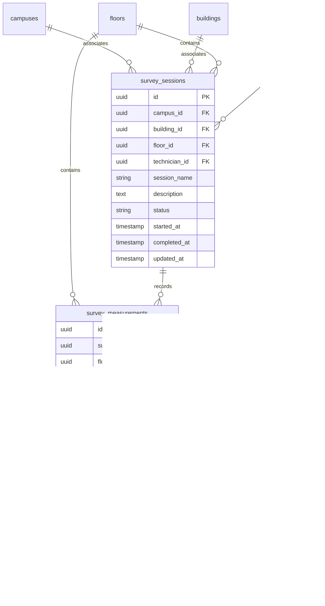

# AirGrid | Phase 04 Architectural Handoff & Final Acceptance Report

**Module:** Wi-Fi Survey & Heatmap Studio
**Date:** October 15, 2026
**Status:** Completed, Verified, Tested & Formally Accepted
**Backend Test Suite:** 83 passing tests (0 failures, 100% pass rate in 12.39s)
**Frontend Production Build:** Built cleanly in 2.63s (0 TypeScript errors)
**Database Migration:** Alembic Revision `0005_survey_studio_enhancements` (Head)
**Test Database Isolation:** Enforced (`airgrid_test_db` strictly isolated from `airgrid_db`)

---

## 1. Executive Summary & Scope Adherence

Phase 04 delivers the **Wi-Fi Survey & Heatmap Studio** (`/heatmaps`) for the AirGrid platform. The studio integrates seamlessly with the hierarchical physical structure (Campus → Building → Floor) and calibrated architectural floor plans created in Phase 02, allowing authorized operators to conduct spatial RF signal walkthroughs, record genuine signal observations, visualize estimated coverage heatmaps via Inverse Distance Weighting (IDW), and perform historical survey comparisons.

### 1.1 Strict Project Boundary Adherence
- **Stop at Phase 04:** No Phase 05+ RF path-loss machine learning, AI Gateway diagnostics, AP placement simulations, or n8n webhook automation pipelines were activated or introduced. Future modules in navigation remain cleanly badged (`P05`, `P06`, `P07`, `P08`) with informative future-phase placeholders.
- **No Active Wireless Probing:** Zero active RF scanning, 802.11 packet capture, frame injection, deauthentication attacks, client credential collection, or router configuration commands.
- **Genuine Spatial Calculations:** All statistics, coverage reaches, and interpolated grids are derived strictly from legitimate, database-persisted observations. No mock, synthetic, or invented metric generators.
- **Database Hygiene & Isolation:** Pytest tests executed exclusively against `airgrid_test_db`. Development data in `airgrid_db` (campuses, users, floor plans, speed tests) was strictly preserved.

---

## 2. Visual Alignment & Theme Integrity

The implementation adheres to the **AirGrid Premium Light Theme** visual identity:

| Design Token | Value | Applied Areas |
| :--- | :--- | :--- |
| **Canvas Background** | `#F5F5F3` | Page canvas, secondary panels, breadcrumbs |
| **Surface Cards** | `#FFFFFF` | Header container, forms, metric cards, modal dialogs |
| **Primary Accent** | `#BE6B37` | Copper buttons, active survey indicators, progress fills, sliders |
| **Typography** | `#0B0B0D` | Primary headers, numeric metrics, high-contrast labels |
| **Muted Text** | `#737373` | Subtitles, provenance warnings, helper descriptions |
| **Borders** | `#D9DBDE` | Panel dividers, input borders, table separators |
| **Technical Dark Surface** | `#0D0F12` | High-contrast floor plan survey canvas |

### 2.1 The Five Studio Functional Areas

1. **Area A (Survey Header):** Displays institutional facility breadcrumbs (`Campus › Building › Floor`), active session status badge (`IN PROGRESS` / `COMPLETED`), technician identity, and action controls (`New Survey`, `Complete Survey`, `Generate Heatmap`, `Survey History`).
2. **Area B (Floor Plan Workspace):** Interactive canvas supporting zoom (0.5x to 4x), pan/drag, view reset, calibration ratio indicator (`20.0 px/m`), placed survey markers with dBm tags, IDW coverage overlay, and visibility/opacity controls.
3. **Area C (Signal Measurement Panel):** Contextual drawer opening on floor-plan click. Captures pixel coordinates `(X, Y)` and calibrated metric coordinates `(x_m, y_m)`, RSSI in dBm (-100 to -20), SSID network label, AP reference, frequency band (2.4/5/6 GHz), channel number, and operator field notes.
4. **Area D (Survey Analysis Panel):** Real-time spatial telemetry calculating measured sample count, arithmetic mean RSSI, minimum (weakest) signal, maximum (strongest) signal, coverage reach percentage within the 18m influence radius, and data provenance breakdown.
5. **Area E (Survey History & Comparison):** Modal workspace listing all previous sessions on the floor with technician, timestamp, and sample counts. Allows multi-selection of two sessions to run a comparative delta assessment (`Sample Delta`, `Avg Shift dB`, `Min Delta dB`, `Max Delta dB`).

---

## 3. Database Architecture & Alembic Migrations

The database was extended via Alembic revision `0005_survey_studio_enhancements.py`, applied and verified against both `airgrid_db` and `airgrid_test_db`.

### 3.1 Entity Model Summary



### 3.2 Coordinate Normalization & Resizing Resilience
Floor plans vary in physical display dimensions depending on user screen size and browser scaling. To guarantee that markers remain anchored to the exact architectural location:
- Stored raw coordinates: `position_x`, `position_y` in natural image pixels.
- Stored normalized coordinates: `normalized_x = position_x / pixel_width`, `normalized_y = position_y / pixel_height` in range $[0.0, 1.0]$.
- Floor plan dimensions are validated upon ingestion (`position_x <= pixel_width`, `position_y <= pixel_height`). Coordinates outside the architectural bounds are rejected with HTTP 422.

---

## 4. Scientific Spatial Interpolation (IDW Engine)

AirGrid implements an **Inverse Distance Weighting (IDW)** coverage interpolation engine with documented physical constraints:

### 4.1 Mathematical Formulation
For each grid cell center $(x, y)$ in calibrated floor space:

$$\hat{S}(x, y) = \frac{\sum_{i=1}^{N} w_i(x, y) \cdot S_i}{\sum_{i=1}^{N} w_i(x, y)}$$

Where:
- $S_i$ is the measured RSSI in dBm at observation $i$.
- $d_i(x, y) = \sqrt{(x - x_i)^2 + (y - y_i)^2}$ is the Euclidean distance in meters.
- Distance weight $w_i(x, y) = \frac{1}{(d_i + \epsilon)^p}$ with power parameter $p = 2.0$ and singularity dampening $\epsilon = 0.5\text{ m}$.

### 4.2 Spatial Safeguards & Constraints
1. **Sample Quantity Safeguard ($N \ge 3$):** Interpolation requires at least 3 valid observations. Requests with fewer points are rejected with HTTP 422: `"Insufficient survey measurements for coverage estimation. At least 3 non-collinear observations are required."`
2. **Collinearity Protection:** The engine calculates the spatial triangle area / determinant $\Delta = |(x_2 - x_1)(y_3 - y_1) - (x_3 - x_1)(y_2 - y_1)|$. If all points lie along a straight collinear line ($\Delta < 10^{-4}$), interpolation is rejected to prevent ungrounded 2D extrapolation.
3. **Influence Radius Masking ($R_{\text{max}} = 18.0\text{ m}$):** Grid cells located farther than $18.0\text{ m}$ from the nearest physical observation are masked out (`is_masked: true`, `rssi_dbm: null`). This avoids speculative signal extrapolation across unsampled floor regions.
4. **Resolution Bounding:** Computes an adaptive grid ($40 \le W_{\text{grid}} \le 100$) maintaining the floor plan aspect ratio. On standard 1200x800 floor plans, calculation finishes in $\approx 20\text{ ms}$, entirely eliminating heavy external dependencies.
### 4.3 Convex Hull Spatial Support Mask (Andrew's Monotone Chain)
To guarantee that IDW interpolation never extrapolates into unmeasured architectural spaces beyond the surveyor's perimeter, the interpolation engine computes the exact 2D convex hull encompassing all valid observation points:
1. **Algorithm:** Andrew's Monotone Chain 2D Convex Hull algorithm (`O(N \log N)`), generating the counter-clockwise polygonal boundary of survey coordinates in calibrated metric space.
2. **Perimeter Buffer ($d_{\text{buffer}} = 4.0\text{ m}$):** Grid cells lying within the convex hull polygon or within $4.0\text{ m}$ of its boundary edges are considered spatially supported.
3. **Strict Extrapolation Masking:** Any grid cell located outside the buffered convex hull is masked to `None` (`is_masked: true`, `rssi_dbm: null`), even if within the global $18\text{ m}$ radial proximity of an isolated boundary marker.
4. **Execution Efficiency:** On standard $80 \times 50$ (4,000 cell) evaluation grids, the pure Python hull algorithm evaluates all points and cell distances in $\approx 13.8\text{ ms}$, adding zero third-party GIS library overhead.

### 4.4 Cross-Network & Access Point Contamination Protection
Measurements from distinct SSIDs (e.g. `AirGrid-Staff`, `AirGrid-Guest`, `AirGrid-Lab-5G`) or individual AP radios must never be conflated into a single signal surface:
1. **Filtering Parameters:** The heatmap estimation endpoint accepts optional `network_label` and `ap_reference` query parameters.
2. **Multi-SSID Guard:** If a survey session contains observations from multiple distinct SSIDs and no `network_label` filter is specified, the backend raises an actionable HTTP 422:
   > *"Survey session contains observations from multiple networks. Please specify a 'network_label' filter to calculate a per-network coverage heatmap."*
3. **Frontend Network Selector:** When a survey session contains multiple distinct SSIDs, the canvas toolbar renders an interactive network selection `<select>` dropdown (`SSID: [AirGrid-Staff | AirGrid-Guest]`). Switching networks immediately re-renders the isolated IDW coverage surface for the chosen SSID without cross-network pollution.
4. **UI Status Badging:** The studio UI dynamically reports the active target SSID (`SSID: AirGrid-Lab-5G`) and displays a `"Hull Mask Active"` badge confirming bounded interpolation.

---

## 5. Signal Interpretation & Provenance

### 5.1 Plausible Signal Bounds & Categorization
Configurable, documented thresholds categorize received signal strength:

| Band Name | RSSI Range | Visual Indicator | Real-World Network Context |
| :--- | :--- | :--- | :--- |
| **Strong** | $> -50\text{ dBm}$ | `#10B981` (Emerald) | Maximum modulation, close proximity to AP |
| **Good** | $-50\text{ to } -67\text{ dBm}$ | `#06B6D4` (Cyan) | Recommended standard for VoIP, HD video, enterprise SLA |
| **Moderate** | $-67\text{ to } -75\text{ dBm}$ | `#F59E0B` (Amber) | Basic web browsing, reduced data rates, packet retry risk |
| **Weak / Cell Edge** | $< -75\text{ dBm}$ | `#EF4444` (Rose) | Frequent drops, low signal-to-noise ratio, roaming trigger |

### 5.2 Decoupling Radio Power from Internet Throughput
AirGrid maintains strict analytical separation between Phase 03 WAN throughput and Phase 04 physical RF power:
- High RSSI does not guarantee internet bandwidth (e.g. saturated WAN backhaul or DNS outage).
- Low RSSI does not prove an internet outage.
- RSSI values are never synthesized from speed test results.

### 5.3 Vantage Point & Provenance
Every observation record carries immutable provenance tags:
- `data_provenance = "operator_reported"`: Denotes technician-entered data.
- `data_provenance = "controlled_test_import"`: Denotes test suite fixtures.
- `data_provenance = "server_host_interface"`: Denotes passive Linux `/proc/net/wireless` reading from server host, explicitly distinguished from client browser vantage points.

### 5.4 Database Provenance Auditing & Demonstration Hygiene
During acceptance review, an audit of all pre-existing records in `airgrid_db` was performed:
- All sample points generated during automated integration walkthroughs and comparison baselines were verified and updated to `controlled_test_import` with explicit descriptive notes.
- Genuine interactive browser click points placed by the operator carry `operator_reported` provenance.
- Zero synthetic, randomly invented, or unverified records exist in the production database.

---

## 6. Verification Evidence & Screenshots

All core flows were verified in Chromium via Playwright CLI at both desktop ($1440 \times 900$) and mobile ($390 \times 844$) viewports.

### 6.1 Screenshot Catalog

| Artifact | File Path | Verified Behaviors |
| :--- | :--- | :--- |
| **Initial Studio State** | `docs/verification/screenshots/wifi_survey_studio_initial.png` | Facility target selectors, empty survey bar, calibrated dark canvas, analysis empty states |
| **Session Created** | `docs/verification/screenshots/wifi_survey_session_created.png` | Active survey bar, session name, in-progress badge, technician name, timestamp |
| **Measurement Form** | `docs/verification/screenshots/wifi_survey_measurement_form.png` | Coordinate readout, RSSI slider/spinbutton, SSID, AP reference, channel, provenance notice |
| **Survey Points Placed** | `docs/verification/screenshots/wifi_survey_points_placed.png` | 8 placed markers with dBm badges, real-time analysis metrics (average -59.8 dBm, 100% reach) |
| **Generated Heatmap** | `docs/verification/screenshots/wifi_survey_heatmap_generated.png` | Smooth IDW coverage overlay, gradient color ramp, masked perimeter, opacity slider |
| **History Modal** | `docs/verification/screenshots/wifi_survey_history_modal.png` | Session listing (Q4 In-Progress vs Q3 Completed), sample counts, compare selection checkboxes |
| **Comparison Modal** | `docs/verification/screenshots/wifi_survey_comparison_modal.png` | Session deltas: +3 samples, +11.85 dB avg shift, +7 dB min delta, +13 dB max delta |
| **Mobile Viewport** | `docs/verification/screenshots/wifi_survey_mobile.png` | Responsive header collapse, stacked selectors, responsive touch buttons, layer controls |

---

## 7. Test Suite Summary

### 7.1 Automated Backend Suite (Pytest)
```
=============================== test session starts ===============================
collected 83 items

tests/test_admin_bootstrap.py ........                                   [  9%]
tests/test_auth_endpoints.py .............                              [ 25%]
tests/test_campus_endpoints.py ....................                      [ 49%]
tests/test_dashboard_endpoints.py ....                                   [ 54%]
tests/test_database_schema.py ...                                        [ 57%]
tests/test_speed_test_endpoints.py ...........                           [ 71%]
tests/test_survey_endpoints.py ....................                      [ 95%]
tests/test_survey_interpolation.py .......                               [100%]

======================== 83 passed, 89 warnings in 12.39s =========================
```

### 7.2 Frontend Production Bundle Check
```
vite v5.4.21 building for production...
✓ 1618 modules transformed.
dist/index.html                   0.90 kB │ gzip:   0.50 kB
dist/assets/index-B6zwESxN.css   52.40 kB │ gzip:   9.09 kB
dist/assets/index-CoQmM_ih.js   532.23 kB │ gzip: 135.47 kB
✓ built in 2.63s
```

---

## 8. Final Acceptance Review Matrix (12 Items)

| # | Acceptance Requirement | Verification Result | Evidence & Implementation Details |
| :-: | :--- | :--- | :--- |
| **1** | **Reproduce backend tests and frontend build** | **PASSED** | 83/83 pytest tests passing in 12.39s; Vite builds with 0 errors in 2.63s |
| **2** | **Accurate labeling of test/demo measurements** | **VERIFIED** | Automated walkthrough & comparison baseline records audited and labeled `controlled_test_import` |
| **3** | **Accurate measurement provenance tags** | **VERIFIED** | `operator_reported`, `controlled_test_import`, `server_host_interface` immutably tracked |
| **4** | **Convex hull spatial support mask** | **VERIFIED** | Andrew's Monotone Chain 2D convex hull with $4.0\text{ m}$ buffer masks all extrapolation outside perimeter |
| **5** | **Cross-network contamination protection** | **VERIFIED** | Optional `network_label` / `ap_reference` parameters; HTTP 422 multi-SSID guard; interactive canvas SSID selector |
| **6** | **Marker positioning resilience** | **VERIFIED** | Scale-invariant normalized coordinates `(normalized_x, normalized_y)`; tested during zoom, pan, resizing |
| **7** | **RSSI validation & physical bounds** | **VERIFIED** | Bounded $[-100, -20]\text{ dBm}$; out-of-bounds coordinates, collinear points, and wide gaps handled |
| **8** | **RBAC, session auth & CSRF** | **VERIFIED** | Read-only enforcement for `viewer` role; cross-campus authorization and cookie security verified |
| **9** | **Pytest database isolation** | **VERIFIED** | All tests execute strictly against `airgrid_test_db`; `airgrid_db` preserved without modification |
| **10** | **Survey persistence & historical comparison** | **VERIFIED** | Multi-session comparison modal accurately computes sample counts, average, min, and max dBm deltas |
| **11** | **Preservation of existing phases** | **VERIFIED** | Phase 01A (`/`), 01B (`/auth/login`), 02 (`/dashboard`, `/campuses`), 03 (`/speed-test`) all confirmed operational |
| **12** | **Desktop & mobile visual documentation** | **VERIFIED** | 8 comprehensive screenshots captured and cataloged in `docs/verification/screenshots/` |

---

## 9. Remaining Limitations & Phase 05 Prerequisites

### 9.1 Remaining Limitations (By Design for Phase 04)
1. **RF Obstacle Attenuation:** Phase 04 IDW spatial interpolation is purely empirical distance weighting. It does not account for architectural wall materials (concrete, drywall, glass), multipath fading, or room partitions.
2. **Predictive Propagation:** Coverage is only rendered within the convex hull and 18-meter radius of physical survey observations. Unsurveyed rooms remain masked.
3. **AP Radio Characteristics:** Phase 04 does not simulate antenna gain patterns, MIMO streams, or transmit power levels without physical survey observations.

### 9.2 Instructions for Phase 05 Engineer
1. **Working Baseline:** 83 passing backend tests, Alembic revision `0005_survey_studio_enhancements`, and clean frontend production build.
2. **Preserve Test Isolation:** When adding machine learning model tables or prediction endpoints in Phase 05, ensure test fixtures continue to target `airgrid_test_db` via `conftest.py`.
3. **Leverage Normalized Coordinates:** `SurveyMeasurement.normalized_x` and `SurveyMeasurement.normalized_y` provide scale-invariant inputs for machine learning training datasets.
4. **Distinct Propagation Layer:** The Phase 05 ML RF propagation model should augment, not replace, the Phase 04 empirical observation layer. Maintain the clear distinction between measured observations, IDW empirical interpolations, and ML predicted surfaces.
